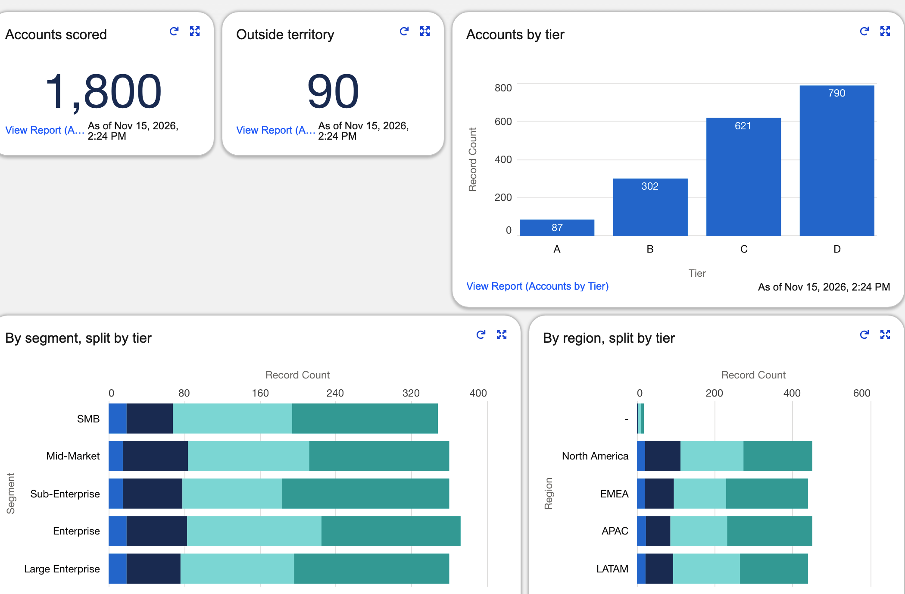
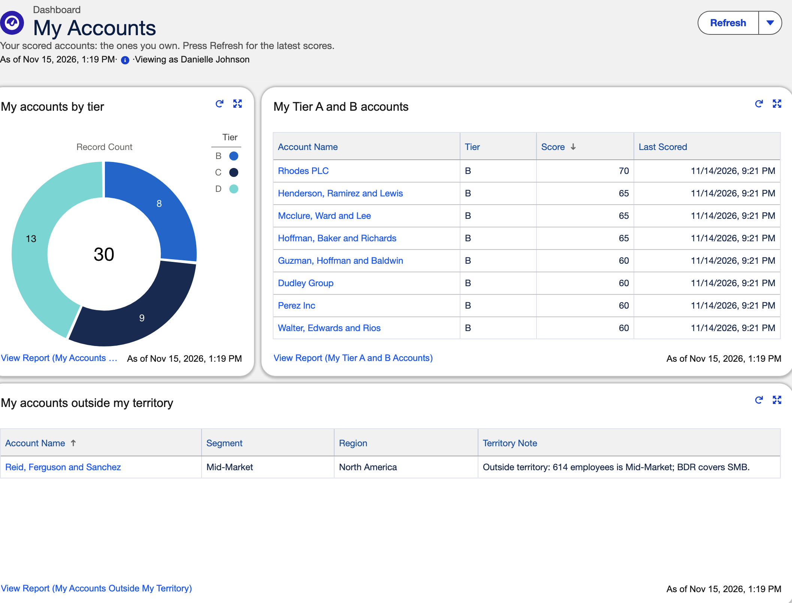
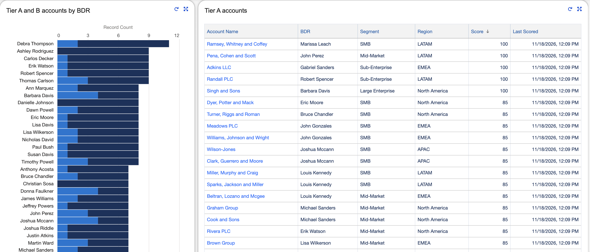

# Account Scoring Engine

**Scores every account on rules you can read, then writes the score, tier and top three reasons into Salesforce on a schedule, so each BDR knows where to look first.**

▶ Demo video: _link added at release_ · Latest release: _v0.1.0 (in progress)_ · [Changelog](CHANGELOG.md) · [Spec](SPEC.md)

**Status:** the scoring engine, the territory check and the Salesforce write-back are built and tested, and the write-back is proven in a Salesforce Developer org with 1,800 sample accounts, including a write that Salesforce refused halfway. The Run button on GitHub is proven with real runs at 300 and at 1,800 accounts, each including a forced failure. The weekday schedule has run by itself on GitHub, on November 16 and 17, each time writing all 1,800 accounts with none failed. GitHub started both runs hours after 7:00 AM. The two Salesforce dashboards are built and seen working in the Developer org, one of them as two real BDR users. The demo video is still to come before v0.1.0 is released.

_The team dashboard, for a manager: every scored account by tier, segment and region. More under [Dashboards](#dashboards)._

## Architecture at a glance

GitHub starts the engine, so nothing in a run needs a person, a laptop or a chat window. A Run button starts it on demand, and a schedule starts it on weekdays from 7:00 AM Eastern.

## How it works

- **Each territory has its own reps.** A territory is a company-size segment in a headquarters region, for example "Enterprise, EMEA". The engine works out both from the account: the segment from employee count and the region from headquarters country. A score ranks an account inside its own segment, so a small company isn't marked down for being small.
- **Accounts in the wrong book get flagged.** The engine compares each account's territory with the territory of the BDR who holds it. A mismatch is flagged with the evidence, such as "205 employees is Mid-Market; BDR covers SMB". It only flags. It never moves an account.
- **Rules live in one file.** `weights.yaml` holds the segment bands, the regions and their countries, five rules worth 100 points and the tier cutoffs. Changing a weight changes no code, and every score records which rules version made it.
- **Every score explains itself.** Each account gets a score, a tier (A to D) and up to three rules that earned it the most points, in plain English. An account that matched no rule says "No rules matched".
- **Built to run unattended.** One command scores all accounts and writes the results into Salesforce. It only updates the fields it owns, it's safe to run twice, and it fails loudly if anything goes wrong. A GitHub workflow runs that command on a schedule and on demand, and a failed run shows red.
- **Each BDR sees their own accounts first.** One shared dashboard, My Accounts, loads as whoever is looking and shows only the accounts that person owns. A second dashboard shows a manager the whole team.
- **Each BDR owns their accounts.** When the engine first creates an account, a Salesforce user with the same name as the account's BDR becomes its owner. After that the engine never touches the owner.

## Quickstart

1. Set up Python 3.13 (the version named in `.python-version`): `python3.13 -m venv .venv && source .venv/bin/activate && pip install --require-hashes -r requirements.lock`. The lock file lists every library with a checksum, and pip refuses any file that doesn't match.
2. Make the sample data: `python data/generate_sample.py`
3. Score it locally: `python run_local.py` (prints tier counts, the top 3 accounts for each segment and the accounts outside their BDR's territory, and saves `output/scores.json`)

To write the scores into a Salesforce Developer org as well:

4. Deploy the Salesforce setup: `sf project deploy start --source-dir force-app --target-org <your org>`. That is the ten fields, two permission sets, nine reports, the two dashboards, and the Account Scoring app with its Home page.
5. In Salesforce Setup, create a user for the engine on the Salesforce Integration licence, give it the Salesforce API Integration permission set licence, and assign it the `Scoring_Engine` permission set. The engine logs in as this user, which can read, create and edit accounts but not delete them.
6. In Setup, create an External Client App with the client credentials flow switched on, running as that user.
7. Copy `.env.example` to `.env` and fill in the org address and the app's key and secret. Git ignores `.env`.
8. Check the connection: `python check_salesforce.py` (reads only; it also confirms the engine can set an owner on a new account)
9. Write and read back: `python write_back.py` (creates the 1,800 accounts the first time, then updates the same 1,800 on every later run)
10. Give each person who should see the dashboards the `Scoring_Viewer` permission set. It lets them read the ten scoring fields and open the Account Scoring app, and nothing else.
11. In Salesforce, open the App Launcher and pick **Account Scoring**. Home shows My Accounts; the team dashboard is under Dashboards. Press **Refresh** after a run: a dashboard shows the numbers from its last refresh.

## Running it on GitHub

Two workflow files in `.github/workflows/` tell GitHub what to run:

| Workflow | Starts | What it does |
|---|---|---|
| `tests` | on every pull request and every push to `main` | installs the libraries from the lock file and runs the tests. It is given no credentials |
| `score-accounts` | on weekdays from 7:00 AM Eastern, and from the Run button | checks the connection to Salesforce (reads only), then runs `python write_back.py` |

To set it up in your own copy:

1. Store the three settings as GitHub Actions secrets. Run each command and paste the value when asked, so the value never appears in the command itself:
   `gh secret set SF_INSTANCE_URL`, `gh secret set SF_CLIENT_ID`, `gh secret set SF_CLIENT_SECRET`
2. Start a run: on GitHub, open **Actions**, choose **score-accounts** and press **Run workflow**. Or from a terminal: `gh workflow run score-accounts.yml`
3. To see a failure on purpose, tick **Force a failure**. The run feeds the engine a file with a duplicate id. The engine's own check refuses it, nothing is sent to Salesforce, and the run ends red.

Things worth knowing:

- **A red run means look.** Nothing retries by itself. A failure before the write changes nothing. The 1,800 accounts go as two requests, and each one is saved whole or not at all: if Salesforce refuses the first, nothing changes; if it refuses the second, the first 1,000 stay saved and the engine says how many accounts were written and how many were not. If a write is sent and Salesforce never answers, the engine says so. In every case running it again is safe.
- **The schedule can start late**, because GitHub queues scheduled runs. The first two scheduled runs started about eight and nine hours after 7:00 AM. The Run button is the way to catch up.
- **Only two steps get the credentials**: the connection check and the write. The step that installs libraries does not.
- **Run logs are written to be safe to read in public.** The engine never prints the org's address, and a message built from a Salesforce reply shows only Salesforce's error code, the account's Sample Id and the field. Salesforce's own wording is never repeated, because it can hold a person's name.
- **To switch the schedule off:** `gh workflow disable score-accounts.yml`. To switch it back on: `gh workflow enable score-accounts.yml`.

All data in this repo is generated sample data. Names come from a fake-data library, so any match with a real company or person is a coincidence.

## Why 1,800 accounts, and how it scales

The sample is 60 BDRs with 30 accounts each. Two limits belong to the free demo org, not to the design:

- **Storage.** A Developer org stores about 2,500 account records, so 1,800 is close to what fits.
- **Logins.** The org has a handful of spare user licences, so two of the 60 BDRs are real Salesforce users who own their accounts and can open their own dashboard. The other 58 are names on accounts. In a real org every BDR would be a user and nothing else would change.

One limit belongs to the way the engine writes. Salesforce saves a request whole or not at all for up to 1,000 records, so the engine sends 1,800 accounts as two requests, in ranking order, and counts what was saved after each one. A run stops at the first request that fails and reports how many accounts were written.

Above about 2,000 records Salesforce recommends its Bulk API 2.0, which saves each record by itself and reports the ones that failed. That is on the roadmap.

## Dashboards

Both dashboards, their reports, the Home page and the app are files in `force-app/`, deployed with the same command as the fields. Both count every account that has a tier, whoever created it.

**My Accounts, for a BDR.** One dashboard shared by every BDR. Salesforce loads it as whoever is looking, and its reports are limited to accounts that person owns. So adding a BDR means adding a user; the dashboard doesn't change. It has three tiles: my accounts by tier, my Tier A and B accounts (highest score first, with when each was last scored), and my accounts outside my territory with the engine's note. It is the Home page of the Account Scoring app.

**Team Account Scoring, for a manager.** Seven tiles: accounts scored, accounts outside their BDR's territory, accounts by tier, by segment and by region (each split by tier), Tier A and B accounts for each BDR, and every Tier A account with its BDR, segment, region, score and the time it was last scored.

Every BDR in the sample holds exactly 30 accounts, so a count of accounts per BDR would be 60 equal bars. The "by BDR" tile counts Tier A and B accounts instead: whose book is richest right now.

What was proven in the Developer org:

- Logged in as each of the two real BDR users, My Accounts showed that user's own 30 accounts and none of the other's. Every name, tier, score and note on screen matched a direct query of the accounts.
- Both of those users are on the cheaper Salesforce Platform licence. It can open the dashboard and the app.
- Every number on the team dashboard equals a direct count of the accounts.

Things worth knowing:

- **"Only their accounts" is about the dashboard.** It doesn't stop a BDR from opening another BDR's account elsewhere in Salesforce. Account sharing in the org is left as it is, and everyone inside the org can open both dashboards.
- **Landing on it.** Salesforce has no setting that forces a page at every login. It returns each user to the app they used last, so a BDR picks Account Scoring from the App Launcher once and lands on My Accounts from then on.
- **Someone who owns no accounts sees empty tiles** on My Accounts. That is correct: a manager's numbers are on the team dashboard.
- **Neither demo BDR holds a Tier A account,** so their "Tier A and B" table shows Tier B only. About 5 in 100 sample accounts are Tier A.
- **Times are shown in the viewer's own time zone.** The engine writes them in UTC.
- **Two things only a person's eyes caught.** Salesforce accepted a number tile that pointed at a plain list report, then showed an error in its place on screen. And a chart's limit on "groups" counts every coloured part of a bar, not every bar, so the first version of the BDR tile quietly showed 32 of 60 BDRs. Tests now guard both, and a check reads what each tile holds after a refresh.
- **Not tested:** deploying `force-app/` to a brand-new org. A check-only deploy of the whole folder passes against the Developer org, which already holds the fields.

## What the score means

The score tells a BDR **where to look first**. It is not a win probability, and it doesn't clear an account for outreach. Ownership, customer status and opt-outs belong to a separate eligibility check (see the roadmap).

Company size decides **who works the account**, not how good it is. The engine puts each account in a segment, and the score ranks it inside that segment:

| Segment | Employees |
|---|---|
| SMB | 50 to 199 |
| Mid-Market | 200 to 699 |
| Sub-Enterprise | 700 to 999 |
| Enterprise | 1,000 to 5,000 |
| Large Enterprise | 5,001 and up |

Fit rules (countries and industry) add up to 50 points at most, so **an account can't reach Tier A on fit alone**. It needs at least two of the three timing signals: a hiring surge, a new HR leader or recent engagement. Full fit plus one timing signal tops out at 70, which is Tier B.

Missing data scores zero but is reported as unknown, never as a negative signal.

## What the territory check means

Every account gets one of three statuses:

| Status | Meaning |
|---|---|
| In territory | The account's segment and region match its BDR's territory |
| Outside territory | The size, the region or both don't match; the note says which and shows the number or country |
| Not checked | The engine couldn't tell, for example the headquarters country isn't in its country table. It says so and doesn't guess |

The check doesn't change the score. An account that has outgrown its BDR's size band keeps its score and is ranked in the segment it now belongs to.

Three limits worth knowing. The check compares against the BDR in the sample data, so it doesn't see a BDR changed by hand in Salesforce. An account one employee over a band edge is flagged the same as one far over, which is why the note shows the number. And real territories can also use named accounts and state or postcode carve-outs; this project uses size plus headquarters region to keep the rule readable.

## Who owns which field

| Field | Owner | The engine… |
|---|---|---|
| Score, Tier, Top Reasons, Last Scored | Engine | writes on every run |
| Segment, Region, Territory Status, Territory Note | Engine | works out and writes on every run, so a change made by hand is overwritten |
| Name, BDR | Salesforce (in this demo, loaded once from sample data) | never overwrites |
| Account Owner | Salesforce | sets once, when it first creates an account and a Salesforce user has the BDR's name; never changes it afterwards |

## Roadmap

Each step ships as its own release with a changelog entry, and gets a new demo video when there's something worth showing. All of it runs on sample data.

**v0.2: Signal buckets, closed-lost re-engage and work queues**

- **Buckets:** each account gets one dated signal type (M&A, new leadership hire, hiring surge, funding, expansion). Rules score timing from it.
- **Closed-lost re-engage:** a lost account keeps its loss reason and gets a re-engage date set by that reason. Budget waits for the next fiscal year, bad timing waits about 6 months, losing to a competitor waits until before their renewal, and no decision maker waits for a new-leader signal.
- **Back with history:** until that date the account stays out of the queue, then it comes back with its history attached.
- **Eligibility and work queues:** customers, opt-outs and disqualified accounts leave the queue with a recorded reason. Accounts sort into Act now, Develop (good fit, no timing yet) and Monitor.

**v0.3: Learn from wins and losses**

- **Closed-won lookalikes:** save what each won account looked like when it was evaluated (size, segment, bucket, signals), then score open accounts on how closely they match that snapshot today.
- **Closed-lost patterns:** count loss reasons by segment and bucket, and lower the weight of patterns that keep losing.
- **A person decides:** weight changes are proposed for a person to approve, saved with a new rules version, and never applied automatically.

**v0.4: AI research, outreach and call prep for Tier A only**

- **Tier A only, to control token spend:** a scheduled job drafts a research brief, a short account plan, a personalized email, a call script, and a call book entry with an outreach task.
- **Built on what the engine knows:** each draft uses the account's bucket, its closest won lookalike and any loss history.
- **Call prep cards:** a daily brief for each contact on today's call list, with the verified signal, an opening question and gaps marked as gaps.
- **A person approves every draft:** nothing is saved until then, every claim keeps its source and date, and thin research becomes a review card instead of a made-up script.

**Later, in no fixed order**

- **Territory reassignment:** when an account sits outside its rep's territory, propose a rep who covers it and let a person approve the move. The engine never moves an account that already has a rep by itself.
- **Score what is already in Salesforce, in three steps:**
  1. Read the accounts BDRs own from Salesforce and score them, including ones a BDR or RevOps adds. Today the engine scores sample accounts from its own file.
  2. Score unassigned accounts (UAR) and every other account too, to watch which ones reach Tier A or B.
  3. Assign those to a BDR automatically. The tier that triggers assignment is a setting: it starts at A and B, and tightens to A only if too many accounts qualify.
- **Real signals:** a signal listener watches public sources for hiring and leadership changes and feeds the engine, replacing the sample flags.
- **Overrides and history:** a person can change a tier with a reason and an end date, with the original score kept, and tier changes are tracked over time.
- **Measurement:** first a shadow run next to the current process, then meetings held and accepted pipeline per account worked, with coverage shown beside results.
- **Rules per segment:** each segment gets its own weights in `weights.yaml`, for example more points for multi-country operations in Enterprise than in SMB.
- **Scale:** write with Salesforce's Bulk API 2.0, which Salesforce recommends above 2,000 records and which saves each account by itself and reports the ones that failed. Rescore only the accounts that changed, plus a 50,000-account test.
