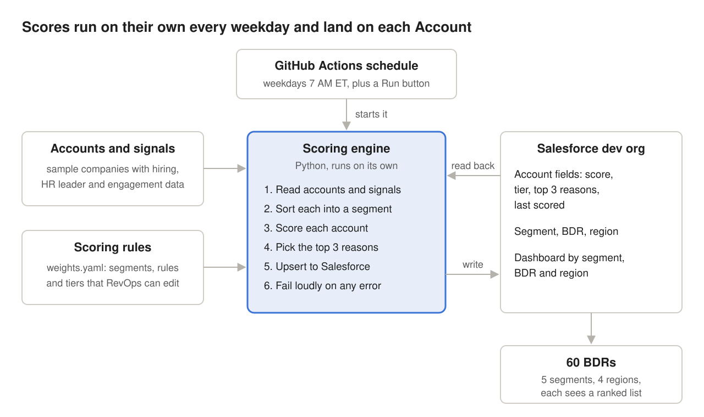
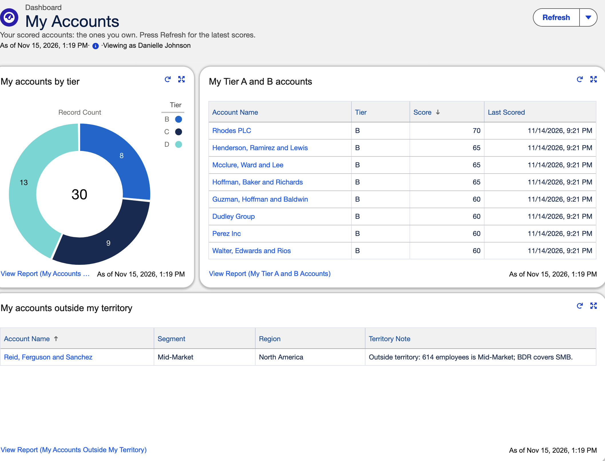
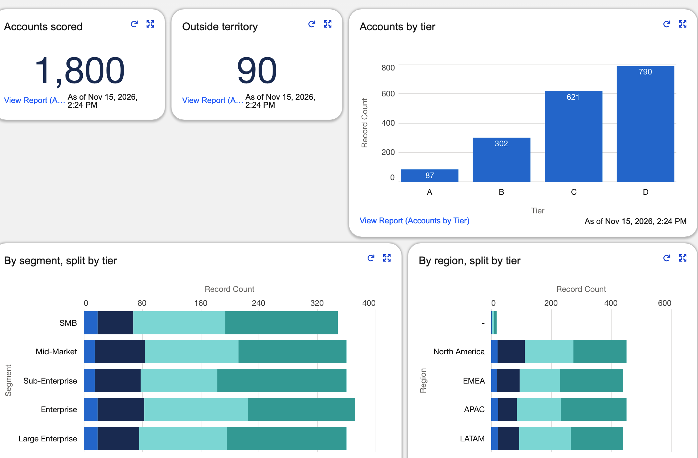
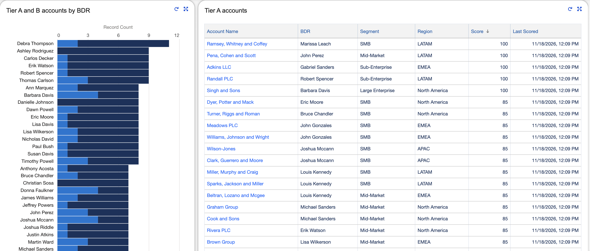

# Case study: Account Scoring Engine

Every weekday, 1,800 accounts get a tier and their top three reasons in plain English, written straight into Salesforce where BDRs already work.

Built by Ayman Abdalla, November 12 to 15, 2026. Python, Salesforce and GitHub Actions.

| Tier A | Tier B | Tier C | Tier D |
|---:|---:|---:|---:|
| 87 | 302 | 621 | 790 |

90 accounts are flagged as outside their BDR's territory, and every count matches a direct query in the org.

## The problem

A BDR opens their book and asks one question: which accounts do I work first, and why? This project answers it by ranking every account on rules anyone can read, putting the result in Salesforce, and making every score explain itself.

| Accounts | BDRs | Rules | Tests | Merged pull requests |
|---:|---:|---:|---:|---:|
| 1,800 | 60 (fictional) | 5, worth 100 points | 414 | 10 |

## How it works

- **Built segments and territories in.** Employee count sets the segment and headquarters country sets the region. An account held by a BDR who covers a different territory is flagged with the evidence. It is never moved.
- **Built the score from fit plus timing.** Fit is worth 50 points at most, so reaching Tier A at 75 points needs at least two of the three timing signals. A good-fit account with no reason to call now does not jump the queue.
- **Built every score to explain itself.** Each account carries up to three reasons in plain English, the rules that earned it the most points.

## Why rules and not a model

- All five rules, the segment bands and the tier cutoffs live in one YAML file. Changing a weight changes no code.
- Every score records the rules version that made it, so a change in ranking can be traced to a change in rules.
- Missing data scores zero and is reported as unknown rather than guessed.

## Salesforce integration

- **Built a least-privilege integration user.** It signs in with OAuth client credentials and has no delete permission.
- **Built an all-or-nothing upsert.** Records are matched on a fixed sample id and sent up to 1,000 per request, each taking under 5 seconds.
- **Built a count-back after every batch.** The run reads back what Salesforce saved and fails loudly when the numbers don't match.
- **Built the org as source.** Ten fields, the permission sets, nine reports, two dashboards and the app are files in this repository, deployed with the Salesforce CLI. A read-only Scoring_Viewer permission set covers people who only look.
- **Built logs that leak nothing.** Logs never print the org address, and errors are reported as codes only.

## Failure tests

- **A duplicate id stops the run.** Nothing is written, and the org stays byte-for-byte the same as before.
- **Salesforce refuses halfway.** The first 1,000 accounts are written, the other 800 are not, the run goes red, and a rerun completes it.

## Dashboards

Both dashboards were checked as two BDR users, not only as an admin.

Looking at the screen caught two faults that a successful deploy did not show. A number tile showed an error in place of its figure, and the by-BDR chart showed only 32 of the 60 BDRs, because Salesforce's limit counts every coloured part of a bar, not every bar. Both were fixed, and tests now guard them.

## How I built it

I built this with AI-assisted development. I wrote the spec and the rules, set the structure, and checked every step myself.

- **Built from a written spec and six plans,** one for each part: local scoring, the territory check, the Salesforce write-back, the scale-up to 1,800 accounts, the scheduled run and the dashboards.
- **Built tests first.** Each test was seen failing before the code that makes it pass.
- **Built in 10 merged pull requests** between November 12 and 15.
- **Built an independent check into every step.** A separate review session checked each slice against its plan: 169 check rounds, 25 of them failed and sent back for fixes, plus a security pass.
- **Built release hygiene in.** Pinned workflow actions, a dependency lock file and a changelog.

## Limits

- It runs in a Salesforce Developer org on fictional sample data only. It has not been used by a real sales team.
- The weekday schedule is in place, and the release (v0.1.0) comes with a demo video.

## What's next

The [roadmap in the README](../README.md#roadmap) covers signal buckets, closed-lost re-engagement and work queues, then learning from wins and losses, each with a person approving changes.

---

Screenshots are from a Salesforce Developer org with fictional data.
