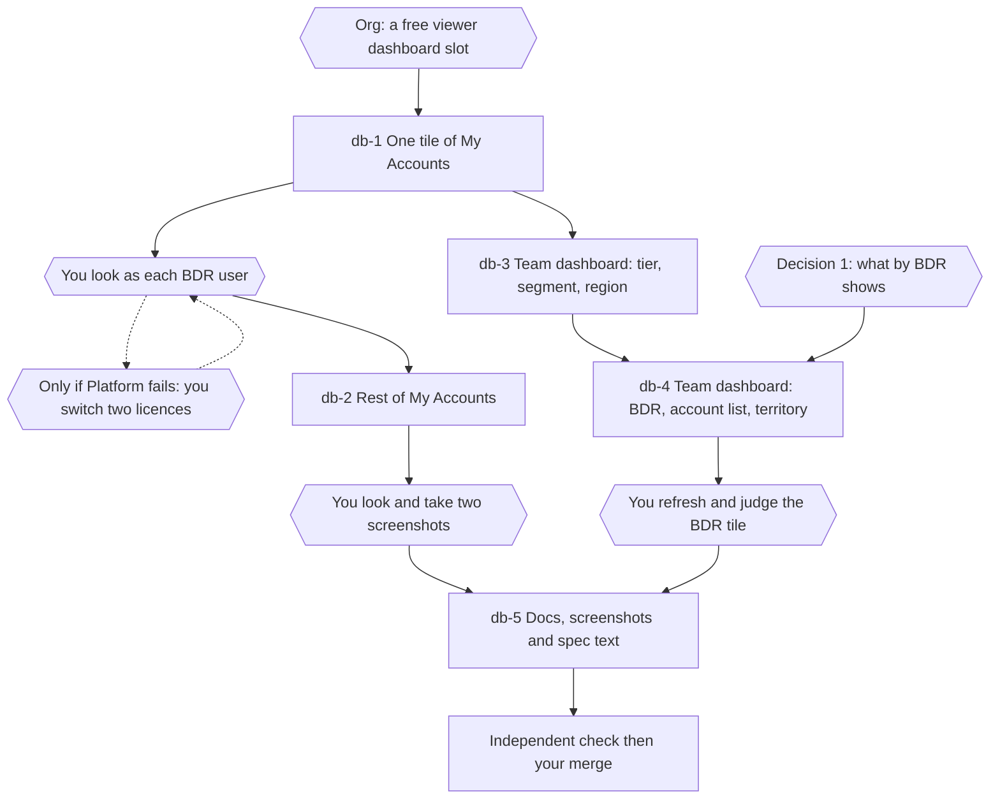

# Dashboards plan

Status: approved by the owner on 2026-11-15 ("go"), with the recommendation taken on each open decision. Source of agreement: [SPEC.md](../../SPEC.md): In scope, Dashboards, Account ownership, the Decisions table, acceptance items 7 and 8, and open items 6 and 7. This file replaces the earlier one-dashboard draft, which was written for 300 accounts and never approved.

## Goal

Two Salesforce dashboards in the Developer org, reading the fields the engine already writes:

- **My Accounts**, one dashboard shared by every BDR. It loads as whoever is looking, and shows only the accounts that person owns: my accounts by tier, my Tier A and B accounts, and my accounts outside my territory.
- **Team Account Scoring**, for a manager: all 1,800 accounts by segment, BDR, region and tier, with the last scored time.

Both are kept as files in `force-app/`, next to the ten fields, so another org gets them with the same deploy command. The plan also settles the spec's two open questions: whether a Salesforce Platform licence can open the BDR dashboard (open item 6), and what "by BDR" shows for a manager (open item 7). The demo video is a separate plan.

## Terms used in this plan

| Term | Meaning |
| --- | --- |
| Report | A saved question to Salesforce, such as "count my accounts in each tier". A dashboard holds no data of its own; every tile draws one report. |
| Tile | One box on a dashboard: a chart, a single big number, or a table. Salesforce calls it a component. |
| Folder | Where Salesforce keeps reports and dashboards. Who may see them is set on the folder. |
| Metadata file | A text file that describes a piece of Salesforce setup. The ten fields are already kept this way. |
| Dry run | A deploy that Salesforce checks in full and then throws away. It proves the files are valid and changes nothing. |
| Read-back | After a deploy, I ask Salesforce to run a report and compare its numbers with a direct count of the accounts. |
| Running user | The person whose access a dashboard uses when it loads its numbers. |
| Viewer dashboard | A dashboard whose running user is whoever is looking at it. Salesforce calls it a dynamic dashboard and limits how many an org may have. |
| Permission set | A bundle of access rights given to a user. |
| Field access | Whether a user may see a given field. A user who cannot see the Tier field gets a report with no tiers in it. |
| Licence | What kind of Salesforce user someone is. Platform is the cheaper kind; the two BDR users have it. |

## What was checked before writing this plan

Read from the org on 2026-11-15 through the admin login, without changing anything:

- 1,800 accounts, every one with a tier and a Sample Id. Tiers: A 87, B 302, C 621, D 790. Segments: SMB 348, Mid-Market 360, Sub-Enterprise 360, Enterprise 372, Large Enterprise 360. Regions: North America 451, EMEA 440, APAC 451, LATAM 440, and 18 with no region. Territory: 1,692 in, 90 outside, 18 not checked. All 1,800 carry one Last Scored time.
- The two BDR users own 30 accounts each and the engine's user owns the other 1,740. Danielle Johnson: Tier B 8, C 9, D 13, and 1 account outside territory. Debra Mullen: Tier B 6, C 10, D 14, and 2 outside. **Neither holds a Tier A account**, so in the demo their "Tier A and B" tables show Tier B only, with 8 and 6 rows.
- **The two BDR users cannot see any of the ten scoring fields today.** Their profile (Standard Platform User) may run reports and read accounts, but has no access to Tier, Score, Last Scored and the rest; only the admin and the engine's user hold the `Scoring_Engine` permission set. Without a fix, the BDR dashboard would be empty for exactly the people it is for.
- By BDR: all 60 BDRs hold between 3 and 11 Tier A or B accounts (5 BDRs hold 3, 5 hold 4, 6 hold 5, 11 hold 6, 14 hold 7, 13 hold 8, 5 hold 9, 1 holds 11). Tier A alone is 0 to 4 a BDR, and 11 BDRs hold none. Every BDR holds exactly 30 accounts, so a plain count per BDR is 60 equal bars.
- The org holds no report or dashboard of ours. Salesforce's own samples are there in hidden folders, and its two sample dashboards are both viewer dashboards.
- Licences: Salesforce Platform 2 of 6 used; full Salesforce 2 of 4 used, so the agreed fallback of two full licences is available.
- The org's sharing default for accounts is read and edit for everyone inside, as the spec says it stays.
- The `score-accounts` workflow is active again, and `main` on GitHub holds the 1,800-account file (pull request 7). The next scheduled run rewrites all 1,800 with a new Last Scored time and the same counts.
- The branch in the working folder, `spec-scale-and-dashboards`, has the same files as `main` on GitHub. The local `main` is one commit behind it.

Carried over from the earlier draft's research (helper review, not an independent check; Salesforce's help pages would not load, so file formats come from real files in public repositories and from a retrieve from this org):

| Fact | Status | Where this plan proves it |
| --- | --- | --- |
| Where the files go: `reports/<Folder>/<Report>.report-meta.xml`, `dashboards/<Folder>/<Dashboard>.dashboard-meta.xml`, and one folder file for each | confirmed | db-1 dry run |
| A report file can be limited to "my accounts" (the report builder's Show Me: My accounts) | expected, not verified | db-1: dry run, read-back, and what each BDR sees |
| A dashboard file can say "run as whoever is looking" | confirmed in real files | db-1 |
| Developer Edition allows 3 viewer dashboards; Salesforce's two samples may count | third-party sources only | db-1: if they count, ours takes the last slot |
| A dashboard file can leave out the running user, and Salesforce uses whoever deployed it | seen in public files, not proven | db-3 dry run; fallback under Design choices |
| A dashboard file retrieved from an org can contain a real username | confirmed: a public repository leaked one this way | a file test guards it from db-1 on |
| A report's numbers can be read without a browser (`sf api request rest`) | worked on two of Salesforce's sample reports | db-1, on our own report |
| A big number can show a grouped report's grand total | not verified | db-3 |
| Stacked bars can draw a report grouped two ways | expected | db-3 and db-4 |
| A report cannot show "the latest Last Scored" as one headline number | could not be verified either way | the plan does not depend on it |

### Layout patterns

Your rule for any screen: look at real examples first, then design an original. Patterns only; no design, wording or branding is copied.

| Seen in | What it does well | How these dashboards use it |
| --- | --- | --- |
| [Zoho CRM home](https://mobbin.com/screens/b2129f37-4cad-45d8-8e9d-1f0403ad6dab) | Every tile title starts with "My", so nobody wonders whose numbers these are | BDR tiles are titled "My accounts by tier", "My Tier A and B accounts", "My accounts outside my territory" |
| [QuickBooks leads](https://mobbin.com/screens/b365e0b4-8854-4a08-b556-d6750dc16934) | A status ring with the total in the middle, and the list to act on right beside it | BDR row 1: tier ring with the total of 30, next to the Tier A and B table |
| [Zendesk Sell "My Dashboard"](https://mobbin.com/screens/a644ba8a-b7a4-45fd-a851-175d5fc6ecf1) | Each tile keeps its frame and its own "nothing here" message when empty | Salesforce does this by itself. A viewer who owns no accounts sees three empty tiles, and the README says so |
| [Fresha sales summary](https://mobbin.com/screens/5607ec62-a778-409b-a1cd-aafc181bf576) | Headline chart above, detail table below, "last updated" near the title | Manager: numbers and charts first, account table last. The scored time sits in the table, because a Salesforce tile cannot show a date as a headline |
| [Apollo deals by rep](https://mobbin.com/screens/963b7af7-59e4-461a-b648-40b291545303) | One horizontal bar per person, never one column per person | Manager "by BDR": one row per BDR, most first |

## Design choices

| Choice | Decision | Why |
| --- | --- | --- |
| How it is built | I write the files, test them with a dry run, then deploy. You look in Salesforce and say what to change. | I cannot click in Salesforce from here, and files can be reviewed, tested and redeployed by anyone. |
| What gets deployed | Only the new permission set and the `reports` and `dashboards` folders. | The ten fields and `Scoring_Engine` are already in the org; re-sending them would overwrite any hand change. |
| Which accounts | Every report counts only accounts that have a tier. | SPEC.md, Dashboards: "every account that has a tier, whoever created it". The draft used the Sample Id; that is dropped. |
| "Mine" | The BDR reports are limited to accounts the viewer owns, and the BDR dashboard runs as the viewer. | SPEC.md, Dashboards and Decisions. |
| Field access for viewers | A new read-only permission set, `Scoring_Viewer`: it lets a user see the ten scoring fields and nothing more. Assigned to the two BDR users. | Their profile cannot see the fields (see above). `Scoring_Engine` would also let them create and edit accounts through it, which a viewer does not need. **Proposed, not agreed:** the spec does not mention viewer access. |
| Folders | One report folder and one dashboard folder, both named Account Scoring, viewable by everyone inside the org. Both dashboards sit in it, so a BDR can also open the manager dashboard. | The spec keeps account sharing open ("dashboard only"), so hiding the team view would hide nothing. A manager-only folder is a later change of one file. **Proposed, not agreed.** |
| Manager dashboard's running user | The file names no one, and Salesforce fills in whoever deploys it. | No username in a public repository. Fallback if the dry run refuses: the file holds a placeholder, and the deploy command fills in the username from a variable in `.env` (`SF_DASHBOARD_RUNNING_USER`), using the Salesforce command line tool's own replacement feature. The username still never reaches the repository. |
| Time zone | Salesforce shows Last Scored in the viewer's own time zone. Read-backs compare in UTC. | Your admin user is set to Pacific time; that is your setting, not this plan's. |
| Stale numbers | The README says: press Refresh after a run. | SPEC.md: a dashboard shows numbers as of the last refresh. |

### My Accounts (the BDR dashboard)

Three tiles, as the spec settles them.

```
Row 1  [ My accounts by tier        ] [ My Tier A and B accounts                      ]
         ring with the total, 4         table, 8: name, tier, score, last scored
                                        date and time; highest score first

Row 2  [ My accounts outside my territory                                             ]
         table, 12: name, segment, region, the engine's note
```

### Team Account Scoring (the manager dashboard)

Seven tiles in three rows. The spec says the layout follows the draft, apart from "by BDR".

```
Row 1  [ Accounts scored ] [ Outside territory ] [ Accounts by tier                    ]
          number, 3           number, 3            column chart, 6

Row 2  [ By segment, split by tier                ] [ By region, split by tier        ]
          stacked bars, 7                             stacked bars, 5
                                                      with a bar for "no region"

Row 3  [ Tier A and B accounts by BDR       ] [ Tier A accounts                        ]
          one row per BDR, 5, tall              table, 7, tall: name, BDR, segment,
          (open decision 1)                     region, score, last scored date and time
```

Three reports feed My Accounts and six feed Team Account Scoring (the by-tier report feeds both the tier chart and the "Accounts scored" number; if a big number cannot use a grand total, that number gets a small report of its own).

## What you do yourself

Short stops at a browser. Click-by-click steps come at each moment.

| When | What |
| --- | --- |
| db-1 | Open My Accounts as each of the two BDR users and say what the ring shows. The quickest way is the Login link next to the user's name in Setup, Users. If that link is missing, either you switch on "Administrators Can Log in as Any User" in Setup, or you sign in as the user in a private window. |
| db-1, only if a Platform user cannot open it | Change the two users to full Salesforce licences in Setup (the agreed fallback), then look again. |
| db-2 | As each BDR user: look at the three tiles and take one screenshot each. |
| db-3, db-4 | Open Team Account Scoring as yourself and say what you see; say whether the BDR tile is readable. |
| db-5 | Take the README screenshot of the manager dashboard, dashboard area only. |
| End | Independent check in a fresh chat, then push, pull request and merge on your say. |

## Slices

Workstream `dashboards`, on a new branch `dashboards` from `main` as it is on GitHub. This plan file is untracked in the working folder today and is committed on that branch at the start of db-1. Each slice gets its row in `docs/agents/build.md` and updates the workstream's own line in `docs/agents/status.md`. Tests are committed and seen failing before the files that pass them.

Every slice that changes the org follows one order: file tests pass, dry run passes, real deploy, read-back, then your look.

| # | Slice | Files and org changes | Change | Acceptance check | Blocked by |
| --- | --- | --- | --- | --- | --- |
| db-1 | One tile of My Accounts, seen by a Platform user | `force-app/main/default/permissionsets/Scoring_Viewer.permissionset-meta.xml`; the report folder and dashboard folder files; the "My accounts by tier" report; the My Accounts dashboard with the ring; `tests/test_dashboard_files.py`; `docs/agents/status.md`. Org: 1 permission set, 2 folders, 1 report and 1 dashboard created; `Scoring_Viewer` assigned to the two BDR users. | The riskiest things first: the "mine" limit, a viewer dashboard and its slot, field access for the BDRs, and the Platform licence (open item 6). | File tests pass, each seen failing first. Dry run succeeds, then the real deploy. Read-back as the admin: the report returns 0 accounts, because the admin owns none, while a direct count of scored accounts is 1,800. You open My Accounts as Danielle Johnson and see B 8, C 9, D 13, total 30; as Debra Mullen, B 6, C 10, D 14, total 30. Open item 6 is then answered and written down: Platform works, or you switch the two users to full licences and the same check passes. Our own dashboard, retrieved into a scratch folder, is inspected for a username. | nothing |
| db-2 | The rest of My Accounts | Two report files (my Tier A and B accounts; my accounts outside my territory) and two tiles; the final two-row layout. Org: 2 reports created, dashboard updated. | The two tables. | Dry run, deploy. As each BDR user you see three tiles and take a screenshot, saved outside the repository. I read the screenshots and compare them with a direct query: Danielle's table lists exactly her 8 Tier B accounts, highest score first, each with a date and time, and 1 account outside territory with its note; Debra's lists exactly her 6 and 2. No name on one screenshot appears on the other. This is spec acceptance item 8. | db-1 |
| db-3 | Team Account Scoring: tier, segment, region | Three report files (by tier; by segment and tier; by region and tier); the Team Account Scoring dashboard with four tiles (accounts scored, by tier, by segment, by region). Org: 3 reports and 1 dashboard created. | The manager dashboard's running user, a big number from a grand total, and stacked bars. | Dry run, deploy. Read-back equals a direct count: tiers 87, 302, 621, 790 and a total of 1,800; every segment and tier; every region and tier, including a group for the 18 with no region. You open the dashboard and see the four tiles. The retrieved file is inspected for a username. | db-1 (the folders and the proven route) |
| db-4 | Team Account Scoring: BDR, account list, territory | Three report files (Tier A and B accounts by BDR; Tier A accounts; accounts outside territory) and the last three tiles; the final three-row layout. Org: 3 reports created, dashboard updated. | The "by BDR" view as decided in open decision 1, and where the last scored time shows. | Dry run, deploy. Read-back equals a direct count: all 60 BDRs with their Tier A and Tier B counts, in order; the Tier A report lists the same 87 accounts a direct query returns, each with the Last Scored time read directly from the org, compared in UTC; the territory number is 90. You press Refresh and confirm seven tiles in three rows, a date and time in the table, and say whether the BDR tile is readable. If it is not, I stop and we take a fallback from open decision 1. This is spec acceptance item 7. | db-3; open decision 1 |
| db-5 | Say what is true, with screenshots | `README.md`, `CHANGELOG.md`, `docs/dashboard-team.png`, `docs/dashboard-my-accounts.png`, `SPEC.md` (see below), `docs/agents/status.md` | README: the two screenshots in place of the placeholder line; the deploy step reworded to cover the fields, both permission sets, the reports and the dashboards (the command does not change); a new step to give each viewer the `Scoring_Viewer` permission set; a line to press Refresh after a run; what a viewer who owns no accounts sees. Changelog: the two dashboards and what was proven. | Every statement points to a check in this plan that passed. Both pictures pass the list under "The screenshots". A dry run of the whole `force-app/` folder succeeds; it changes nothing, and it proves the files against this org, not a brand-new one. `pytest` passes. | db-2, db-4 |

If a dry run refuses a file, I fix the file and run it again. That changes nothing in the org. If the same file is refused three times, I stop and show you the message.

### What the file tests check

`tests/test_dashboard_files.py` reads the files in `force-app/` with Python's built-in XML reader, needs no network, and fails if:

- a dashboard file contains a running user, an owner, or anything shaped like an email address (the placeholder from the fallback is the one allowed value);
- the My Accounts dashboard is not set to run as the viewer, or one of its reports is not limited to the viewer's own accounts;
- a Team Account Scoring report is limited to the viewer's own accounts;
- any report is missing the "has a tier" filter;
- a tile names a report that is not in the repository;
- a report or tile uses an Account field other than the ten in `force-app/`, the account name and owner, and the created date that every report file carries;
- `Scoring_Viewer` grants anything beyond reading: any edit, create or delete;
- two tiles overlap on the grid, or one runs past the last column.

### The screenshots

A picture cannot be searched the way text can, so I look at each one before it is committed. It shows the dashboard area only, cropped, and none of: the browser's address bar, tabs or bookmarks; the Salesforce header; the window title, menu bar or dock. Names in the picture are generated sample names. I re-save the file to drop what the screenshot tool recorded about the machine, and say so if I cannot show that it worked. The screenshots from db-2 are evidence and stay in the scratch folder; only the two cropped pictures go into `docs/`.

### Proposed changes to SPEC.md

The spec is yours. Each of these is shown to you as exact text in db-5 and made only with your yes at that moment:

1. Open item 6: settled, with what db-1 found (Platform works, or the two full licences are in use).
2. Open item 7: settled, with what "by BDR" shows.
3. Dashboards: the manager paragraph lists its seven tiles; one sentence says a viewer needs the `Scoring_Viewer` permission set to see the scoring fields; one says both dashboards are open to everyone inside the org.
4. Acceptance items 7 and 8 ticked, if their checks passed.

## Loop check

Not applicable: this plan adds no job that repeats by itself. The dry-run retry is run by hand, stops at three tries a file, and changes nothing in the org.

## Dependencies

| Dependency | Needed by | Exists now? | Provider | If missing |
| --- | --- | --- | --- | --- |
| Developer org connected as `scoring-dev`, 1,800 scored accounts | all slices | yes, read on 2026-11-15 | you | not applicable |
| Salesforce command line tool 2.158.7, logged in as your admin user | all slices | yes | installed | not applicable |
| The two BDR users, active, owning 30 accounts each | db-1, db-2 | yes | created by you in the scale-up | not applicable |
| A way for you to open Salesforce as each BDR user | db-1, db-2 | not checked: the Login link depends on an org setting I did not read | you | you sign in as the user in a private window; without either, acceptance item 8 cannot be checked |
| A free viewer-dashboard slot | db-1 | unknown: the limit is believed to be 3 and Salesforce's two samples may count | the org | the deploy is refused and nothing changes; I stop and show you the message. Removing one of Salesforce's samples would be a deletion needing its own yes |
| Two spare full Salesforce licences | db-1, only if Platform fails | yes, 2 of 4 used | the org | not applicable |
| Reading a report's numbers without a browser | every read-back | worked on Salesforce's sample reports; proven on ours in db-1 | Salesforce | you read the numbers off the screen and the record says "checked by eye" |
| `main` with the 1,800-account work | branch point | yes on GitHub; the local copy is one commit behind | merged | the branch is made from GitHub's `main` |
| Your decision on "by BDR" | db-4 | no | you | approving the plan takes the recommendation |

## Verification

| Requirement (SPEC.md) | Check | Runs now? |
| --- | --- | --- |
| BDR dashboard loads as the viewer and shows only accounts the viewer owns | db-1: admin sees 0, each BDR user sees their own 30; file test | after db-1 |
| Open item 6: a Platform licence can open it | db-1, with a real Platform user | after db-1 |
| BDR tiles: by tier with the total; Tier A and B sorted by score with name, tier, score, last scored; outside territory with the note | db-2 screenshots compared with a direct query | after db-2 |
| Acceptance 8: tier counts add up to 30, no other BDR's account, the two users differ | db-1 numbers (8, 9, 13 against 6, 10, 14) and db-2 name comparison | after db-2 |
| Both dashboards count every account that has a tier | file test; read-back totals of 1,800 | after db-3 |
| Manager: by tier, by segment, by region | db-3 read-back | after db-3 |
| Manager: by BDR (open item 7) | db-4 read-back for all 60 BDRs, and your look | after db-4 |
| Manager: with the last scored time | db-4: the Tier A table's time equals the time read from the org, and you see it on screen | after db-4 |
| Acceptance 7 | db-3 and db-4 together | after db-4 |
| "Only their accounts" is about the dashboard, not sharing | no sharing setting is changed; checked by reading the deploy | after db-1 |
| No username or org detail in the repository | file tests; the screenshot check; the scan of every commit before any push | file tests after db-1 |

Not covered: that the dashboards look right, which only you can judge; and the real BDR users are two of 60, so "every BDR sees only their own" is proven for two people and one admin.

## Security

- **Worth protecting:** your Salesforce username and the org's address and ids, which must not reach a public repository; the org's setup, which this plan changes; what each user may see and do.
- **Who can reach it:** the files go into a public repository. A retrieved dashboard file can carry the deploying user's username. A screenshot can show the address bar, your name and your picture. Inside the org, everyone can view both dashboards.
- **What stops misuse:** no dashboard file names a running user, and a test fails if a username, an owner or an email-shaped string appears. Retrieved files are inspected in a scratch folder and never copied in as they come. Screenshots are checked by eye. Deploys use your admin login on this laptop; GitHub and the engine's user get no new access, and `Scoring_Engine` is not changed.
- **New access given:** `Scoring_Viewer` lets the two BDR users read the ten scoring fields on accounts they could already open. A test fails if it ever grants more than reading. Because the spec keeps account sharing open, a BDR can still open another BDR's account outside the dashboard, and now sees its score there too; that is the agreed "dashboard only" limit, stated in the README.
- **Logging in as a BDR user:** done by you, in your browser. No BDR password is asked for, written down or used by me.
- **What a deploy can change:** one permission set, two folders, nine or ten reports and two dashboards. It cannot change accounts. Removing any of it again is a deletion and needs its own yes.

## Risks, open decisions and fog

Open decisions. Approving the plan accepts each recommendation unless you say otherwise.

| # | Decision | Recommended | Alternatives and what they cost |
| --- | --- | --- | --- |
| 1 | **What "by BDR" shows on the manager dashboard (open item 7).** Every BDR holds 30 accounts, so a plain count says nothing. Tier A and B together range from 3 to 11 a BDR. | One row per BDR for all 60, each bar split into Tier A and Tier B, most first. It answers "whose book is richest right now" and hides nobody. The cost: 60 rows is at the edge of what a Salesforce chart shows legibly, so you judge it in db-4. | (a) A table of the 60 BDRs with a Tier A and a Tier B count: always legible, less visual, and its file format is less certain. This is the fallback if the bars are unreadable. (b) A segment filter at the top of the dashboard, so the chart shows 12 BDRs at a time: closest to how a real manager works, but filters are an unproven file format and a sixth slice. (c) Tier A only: 11 BDRs would show nothing. (d) Only the top 15: the cut falls inside a tie. |
| 2 | Viewer access through a new read-only `Scoring_Viewer` permission set. | Yes. | Give the BDRs `Scoring_Engine`: no new file, but it lets them create and edit accounts through it and blurs what the engine's own access is. |
| 3 | Both dashboards in one folder open to everyone inside the org. | Yes. | A second folder for the manager dashboard, shared with you only: more realistic, one more file, and it protects nothing while account sharing is open. |

Risks:

- Risk: a Platform user cannot open a viewer dashboard. -> db-1 finds out first; the two full licences are the agreed fallback and are free.
- Risk: the viewer-dashboard slot is not free. -> the dry run or deploy in db-1 is refused and nothing changes; I stop and show you.
- Risk: the "mine" limit is spelled wrongly in the file and the report quietly shows everything. -> the admin read-back must return 0, and each BDR must see exactly 30.
- Risk: neither demo user holds a Tier A account, so the "Tier A and B" table shows only Tier B. -> stated here and in the README; it is true to the data. Choosing different BDRs would mean new users and a reload, which this plan does not propose.
- Risk: the running-user choice for the manager dashboard is refused. -> the placeholder fallback under Design choices.
- Risk: a number on a dashboard is wrong and nobody notices. -> every report is compared with a direct count.
- Risk: a scheduled run lands in the middle of a read-back and changes the Last Scored time. -> counts do not change between runs; the time is read and compared in one go, and repeated if a run was in flight.
- Risk: a retrieved file or a screenshot leaks your username. -> the file test, the scratch-folder inspection and the screenshot check.
- Risk: the dashboard shows old numbers in the demo. -> press Refresh; the tables show when the scores were written.

Fog:

- Fog: whether a brand-new org accepts the whole `force-app/` folder in one go. Revisit before the repository is shown to anyone who might deploy it.
- Fog: filters on the manager dashboard and a dashboard that refreshes itself after each run. Not in v0.1; revisit after you have used it.
- Fog: the `scale-to-1800` line in `docs/agents/status.md` still says its check and ship are to come, though pull request 7 is merged. This workstream may edit only its own line; say if you want that line brought up to date.

## Flow



## Approval

Approving this plan authorizes: creating the branch `dashboards` from `main` as it is on GitHub; writing the files named in the slices; dry-run deploys to the `scoring-dev` org; real deploys that create or update the `Scoring_Viewer` permission set, the two folders, the nine or ten reports and the two dashboards, and nothing else; assigning `Scoring_Viewer` to the two BDR users; in db-5, a dry run of the whole `force-app/` folder; read-only queries and report runs, which record "last run" on our own reports and change nothing else; retrieving our own reports and dashboards into a scratch folder outside the repository; committing each finished slice and its build record on the branch; and my recommendation on each open decision you do not change.

It does not authorize: pushing, opening a pull request or merging; editing SPEC.md before you have seen the exact text; deleting anything in the org, including Salesforce's sample dashboards; changing the ten fields, `Scoring_Engine`, licences, login settings, time zone or sharing; changing accounts or their owners; anything on GitHub; tagging a release; or the demo video. Each is asked for at its moment. You look at the dashboards, log in as the BDR users and take the screenshots.
