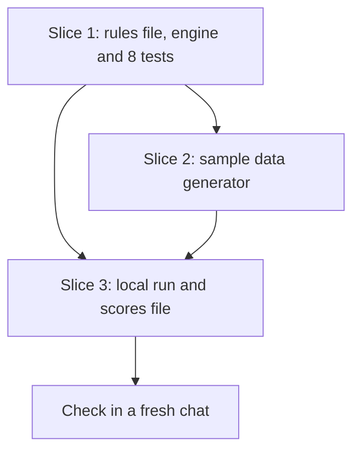

# Local scoring engine plan

Status: proposed, awaiting approval. Source of agreement: [SPEC.md](../../SPEC.md) and the build prompt agreed in chat on 2026-11-14.

## Goal

Build the part of v0.1 that runs on a laptop: generate 300 sample accounts, score each one from the rules in `weights.yaml`, and print and save the results. It serves a BDR team lead who wants a ranked, explained list, and it is the base the Salesforce write-back and the scheduled run are added to later. Salesforce, GitHub Actions and the dashboard are not in this plan.

## Decisions already made

- Tier A stays at 75 and up. It needs at least two timing signals.
- `top_reasons` lists the rules that matched, highest points first, three at most. No match gives the single line "No rules matched".
- Rules with equal points keep their order in `weights.yaml`.
- An empty field scores zero for its rule and is listed in `unknown`.
- Names come from Faker, pinned at version 37.12.0 and seeded.
- Work happens on the branch `local-scoring-engine`. Nothing is pushed or merged without a separate yes.

## Slices

| # | Slice | Files | Change | Acceptance check | Blocked by |
| --- | --- | --- | --- | --- | --- |
| 1 | Rules and engine | `.gitignore`, `requirements.txt`, `weights.yaml`, `scoring/__init__.py`, `scoring/engine.py`, `pytest.ini`, `tests/test_engine.py` | The rules file holds the version, five segment bands, five rules and four tiers. The engine scores one account and returns segment, score, tier, top_reasons, unknown and rules_version. It knows four kinds of check (`at_least`, `at_most`, `is_true`, `in_list`) and no field names, points or thresholds. | `pytest` shows 8 tests passing. Each test is seen failing before the engine code that makes it pass is written. | nothing |
| 2 | Sample data | `data/generate_sample.py`, `data/accounts.json` | The generator reads the segment bands from `weights.yaml` and writes 300 accounts for 60 BDRs (5 segments x 4 regions x 3 BDRs x 5 accounts). | Running it twice gives a byte-identical file (same checksum). A count shows 300 accounts, 300 unique ids, 60 unique BDRs with 5 accounts each, and every employee count inside its BDR's band. | 1 |
| 3 | Local run | `run_local.py` | Loads the accounts, scores them all with one UTC time for the run, prints tier counts for each segment with a grand total, prints the top 3 accounts for each segment, and saves `output/scores.json`. | `python run_local.py` prints a grand total of 300, shows all four tiers somewhere in the data, and lists 3 accounts for each of the 5 segments ranked by score then id. `output/scores.json` has 300 records with the 8 agreed fields. | 1, 2 |

### The eight tests in slice 1

1. An account that matches every rule scores 100 and is tier A.
2. An account that matches none scores 0, is tier D and has the reason "No rules matched".
3. Reasons come out highest points first, with equal points in `weights.yaml` order.
4. Segment edges: 199 is SMB, 200 and 699 are Mid-Market, 700 and 999 are Sub-Enterprise, 1000 and 5000 are Enterprise, 5001 is Large Enterprise.
5. Both fit rules plus a hiring surge scores 70 and is tier B.
6. An account that matches two rules lists two reasons.
7. Empty `days_since_engaged` doesn't crash, earns 0 for that rule and appears in `unknown`.
8. `days_since_engaged` of 14 matches the engagement rule; 15 doesn't.

### Sample data settings (slice 2)

- Seed: 42, used for both Faker and Python's `random`.
- Large Enterprise is capped at 50,000 employees.
- Proposed signal rates, stated in a comment at the top of the generator: hourly-workforce industry about 50%, 3 or more countries about 50%, hiring surge 30%, new HR leader 20%, engaged in the last 14 days about 25%, engagement unknown about 20%.
- With those rates, roughly 14 of 300 accounts should be Tier A. The real tier counts are shown after slice 3, and the rates can be tuned then.

## Dependencies

| Dependency | Needed by | Exists now? | Provider | If missing |
| --- | --- | --- | --- | --- |
| Python 3.9.6 in `.venv` | all slices | yes | already set up | not applicable |
| PyYAML 6.0.3 | slices 1 to 3 | yes, installed in `.venv` | pinned in `requirements.txt` | not applicable |
| pytest 8.4.2 | slice 1 | yes, installed in `.venv` | pinned in `requirements.txt` | not applicable |
| Faker 37.12.0 | slice 2 | yes, installed in `.venv` | pinned in `requirements.txt` | not applicable |

No account, credential, network call or outside service is needed.

## Verification

| Requirement | Check | Runs now? |
| --- | --- | --- |
| Spec acceptance 1: tier counts add up to 300, top 3 for each segment with BDR, region and reasons | Slice 3 run output | after slice 3 |
| Spec acceptance 2: `pytest` passes, including the 8 segment edges | Slice 1, test 4 | after slice 1 |
| No rule logic outside `weights.yaml` | Reading `scoring/engine.py` for field names, points and thresholds (checked by reading), plus changing one weight in a scratch copy and seeing the score change with no code edit | after slice 1 |
| Same data on every run | Slice 2 checksum comparison | after slice 2 |
| Same ranking on every run | Run `run_local.py` twice and compare the files with `scored_at` removed | after slice 3 |
| Missing data reported as unknown | Slice 1, test 7 | after slice 1 |
| Tier A needs two timing signals | Slice 1, test 5 | after slice 1 |

Spec acceptance checks 3 to 6 (Salesforce, forced failure, dashboard, demo video) are outside this plan.

## Security

None for the engine itself: it is a local script with no network access, no secrets and no outside input beyond a file it generates. Three habits are set now because later work depends on them: `.gitignore` covers `.env` before any Salesforce credential exists, the rules file is loaded with `yaml.safe_load` (which reads data and can't run code), and all three libraries are pinned to exact versions.

## Risks, open decisions and fog

- Risk: Python 3.9 is past its end of support. The code is written to run on 3.9 and newer, and the GitHub Actions work can pick a newer version later.
- Risk: the tier spread may look thin, because Tier A needs two timing signals. The counts are shown after slice 3 and the rates tuned before the data is committed.
- Risk: Faker gives different names in a different version. The version is pinned.
- Note: the doc edits made earlier today (README.md and SPEC.md) are uncommitted on `main`. They move onto the `local-scoring-engine` branch with this work.
- Note: CHANGELOG.md already lists v0.1.0 items that aren't built. It is left alone until the release checklist is run.
- Fog: whether every segment needs its own Tier A accounts for the dashboard; revisit when the dashboard is built.
- Open decision: none.

## Flow

## Approval

Approving this plan authorizes creating the branch `local-scoring-engine`, writing the files in the three slices, running the generator, the tests and the local run, and committing each finished slice on that branch. It does not authorize pushing, opening a pull request, merging, or any Salesforce or GitHub Actions work.
