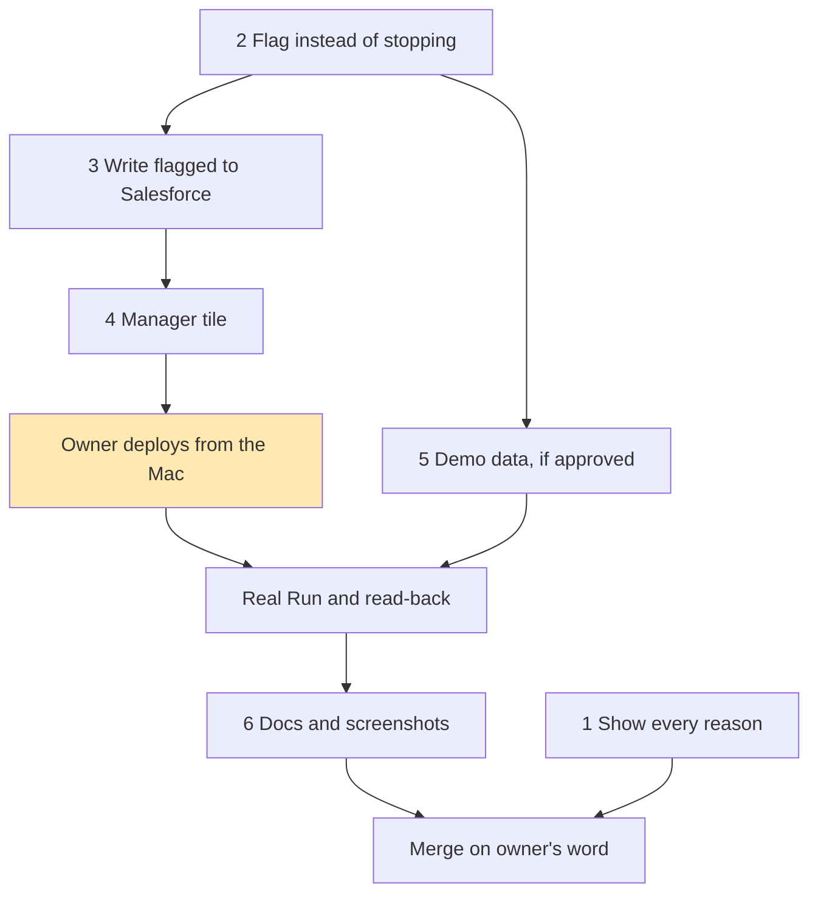

# Needs review and all reasons plan

Status: approved by the owner on 2026-11-18 ("yes, go with your recs"), including slice 5 (six demo accounts under 50). Source of agreement: the owner's messages in chat on 2026-11-18: "why is the 4th reason hidden? can we fix that, why a company under 50 stops the whole run, it should just be skipped and ignored and identified and flaggged for human review", then "1, go" (flag in Salesforce, not in the run log only).

This plan changes two settled spec items: "top three reasons" (In scope and the output table) and "employees: 50 or more" (Sample data). Approving the plan approves those two spec changes; slice 5 writes them into SPEC.md.

## Goal

Two changes, so the demo shows a system that keeps working when the data is messy:

1. **Every reason shows.** An account shows every rule it matched, highest points first, not only the top three. An 85-point account shows four reasons that add up to 85.
2. **A bad account is flagged, not fatal.** An account that fits no segment (fewer than 50 employees, or no employee count) is not scored. The run carries on with every other account, and the flagged account lands in Salesforce with no score or tier, Territory Status "Needs review" and a note that says why. Managers see a "Needs review" tile on the team dashboard. A broken file (for example a duplicate id) still stops the run before anything is written, as today.

## Terms used in this plan

| Term | Meaning |
| --- | --- |
| Flagged account | An account the engine could not put in a segment, so it was not scored. |
| Needs review | The new Territory Status value a flagged account gets in Salesforce. |
| Picklist value | One of the allowed choices in a Salesforce drop-down field. Territory Status only accepts listed values, so "Needs review" has to be deployed before the engine can write it. |
| Deploy | Sending the files in `force-app/` to the Developer org with the Salesforce command line on the Mac. |

## Defaults chosen (cheap to change, not asked)

- `max_reasons` becomes 5 (all five rules) and `version` becomes 2, so every score records that it lists every reason. No rule, band or tier cutoff changes, so every score and tier stays the same.
- Flagged: employee count missing, not a whole number, or below the smallest segment's minimum. Large Enterprise has no upper limit, so nothing is flagged for being too big.
- A flagged account still gets its region (from its country), its BDR and its Last Scored time, so the read-back after each write counts it like any other account. Score, Tier, Segment and Top Reasons are left empty. For an account already in Salesforce, those fields are cleared, so an old score never sits next to a "Needs review" flag.
- Note wording: `Needs review: 30 employees is below the smallest segment, SMB (50 to 199).` or `Needs review: no employee count.`
- Flagged accounts are written after the scored ones, in id order.
- The "Needs review" tile goes on the manager dashboard only. My Accounts counts only accounts with a tier, so a flagged account drops out of a BDR's tier ring and lists, as it should.

## Slices

| # | Slice | Surfaces | Change | Acceptance check | Blocked by |
| --- | --- | --- | --- | --- | --- |
| 1 | Show every reason | `weights.yaml`, `scoring/engine.py` (no logic change expected), `run_local.py`, tests | `max_reasons: 5`, `version: 2`; tests for an 85-point account with four reasons and a 100-point account with five | `pytest` passes; `python run_local.py` prints four reasons for an 85-point account; the longest reason list fits the 1,000-character Top Reasons field | nothing |
| 2 | Flag instead of stopping, locally | `scoring/engine.py`, `run_local.py`, `weights.yaml` (new status "Needs review"), tests | An account that fits no segment returns a flagged result instead of an error; `run_local.py` counts it and lists it under "Needs review" | A test file with accounts of 30 employees and no employee count: `run_local.py` exits 0, scores the rest, lists both with their notes. A duplicate id still stops the run | nothing |
| 3 | Write flagged accounts to Salesforce | `force-app/.../Territory_Status__c` (new value), `salesforce/records.py`, `write_back.py`, `check_salesforce.py`, tests | Flagged rows pass the pre-write check with empty Score, Tier, Segment and Top Reasons; existing accounts get those fields cleared; the final line reads "Scored N, needs review M, written W, failed 0" | Fake-Salesforce tests: a 1,800-account run with flagged accounts writes all of them, clears old scores, and counts match. Then, after the deploy (dependency below), a real Run writes them | 2 |
| 4 | Manager tile | new report `Accounts_Needing_Review`, `Team_Account_Scoring` dashboard, dashboard tests | An eighth tile, "Needs review": a table of flagged accounts with BDR, note and Last Scored | Dashboard file tests pass; after deploy and a run, the tile lists exactly the flagged accounts | 3 |
| 5 | Demo data shows it (see Open decision) | `data/generate_sample.py`, `data/accounts.json`, tests, README, CHANGELOG, SPEC.md, recording script | Six of the 1,800 sample accounts (ACC-0075, then every 300th: 0375, 0675, 0975, 1275, 1575) get fewer than 50 employees. None of them is an every-20th or unknown-country account | Generator rebuilds the file byte for byte; `run_local.py` shows 1,794 scored and 6 needing review; README, SPEC and CHANGELOG numbers match the run | 2 |
| 6 | Docs and screenshots | README, CHANGELOG, SPEC.md, `docs/*.png`, recording script | Wording says "every reason" and describes Needs review; new tier and territory counts; screenshots retaken after the real run | Every number in README and SPEC matches a fresh `run_local.py` and the dashboards | 3, 4, 5 and the deploy |

## Dependencies

| Dependency | Needed by | Exists now? | Provider | If missing |
| --- | --- | --- | --- | --- |
| Salesforce command line logged in to the Developer org | deploy for slices 3 and 4 | yes, on the owner's Mac only | owner runs two commands: a dry run, then the deploy | slices 3 and 4 are proven by fake-Salesforce tests only; the real Run waits |
| GitHub Actions secrets for the org | the real Run | yes | already set | none |
| Pull request 11 (schedule wording) | README and CHANGELOG edits | open, not merged | owner's "merge" | this branch starts from pull request 11's branch, so either order works |
| Screenshots of both dashboards | slice 6 | old ones exist | owner, on the Mac, after the real Run | README keeps the old pictures and says they show the earlier numbers |

## Verification

| Requirement | Check | Runs now? |
| --- | --- | --- |
| Every matched reason shows | slice 1 tests and `run_local.py` output | yes |
| Under 50 or no count is skipped, not fatal | slice 2 tests | yes |
| Flagged accounts reach Salesforce with the flag and no old score | slice 3 fake-Salesforce tests; real Run read-back after deploy | tests yes; real Run after deploy |
| Managers can see them | slice 4 file tests; tile read after deploy and Run | tests yes; tile after deploy |
| A broken file still stops the run | existing forced-failure test and a red "Force a failure" Run | yes |
| Nothing else moved | every tier, segment and territory count for the other accounts is unchanged against today's `output/scores.json` | yes |

## Security

What is worth protecting: the org credentials (GitHub secrets `SF_INSTANCE_URL`, `SF_CLIENT_ID`, `SF_CLIENT_SECRET`, unchanged) and the run logs, which are public-safe today. The new note and log lines carry only the employee count, the segment name and the Sample Id, never a name from Salesforce, so the codes-only log rule holds. The new report reads only the existing scoring fields plus Name and BDR, under the existing `Scoring_Viewer` permission set, which gains no new access. No new outside input: the accounts file is the same sample file.

## Risks, open decisions and fog

- **Open decision (owner): slice 5, put six under-50 accounts in the demo data?** Recommended yes: without them the tile is empty on the video and the real Run never proves the flag. The cost: tier and territory counts change slightly (1,794 scored), and the dashboard screenshots need retaking.
- **Risk: order of deploy and merge.** If the code reaches `main` and the scheduled run writes "Needs review" before the picklist value is deployed, Salesforce refuses the whole request and the run goes red. Limit: deploy from this branch first, then merge; the plan's merge step checks that the value is in the org.
- **Risk: clearing fields.** Sending an empty value must clear Score and Tier, not be ignored. Limit: a fake-Salesforce test now, and the real read-back after the Run checks that flagged accounts have no tier.
- **Risk: the recording moves.** This adds a build round, a deploy on the Mac and new screenshots before recording. The Nov 6 email promised the video "within the next week or so".
- **Fog:** whether BDRs should see their own flagged accounts too. Revisit after the video.

## Flow

## Approval

Approving this plan authorizes slices 1 to 4 and 6 on the branch `needs-review-and-all-reasons`, commits on that branch, and the two spec changes named at the top. Slice 5 needs its own yes (the open decision). Outside this plan: pushing, merging, deploying, sending anything to Dayforce, and making the repository public, which each still need the owner's yes.
