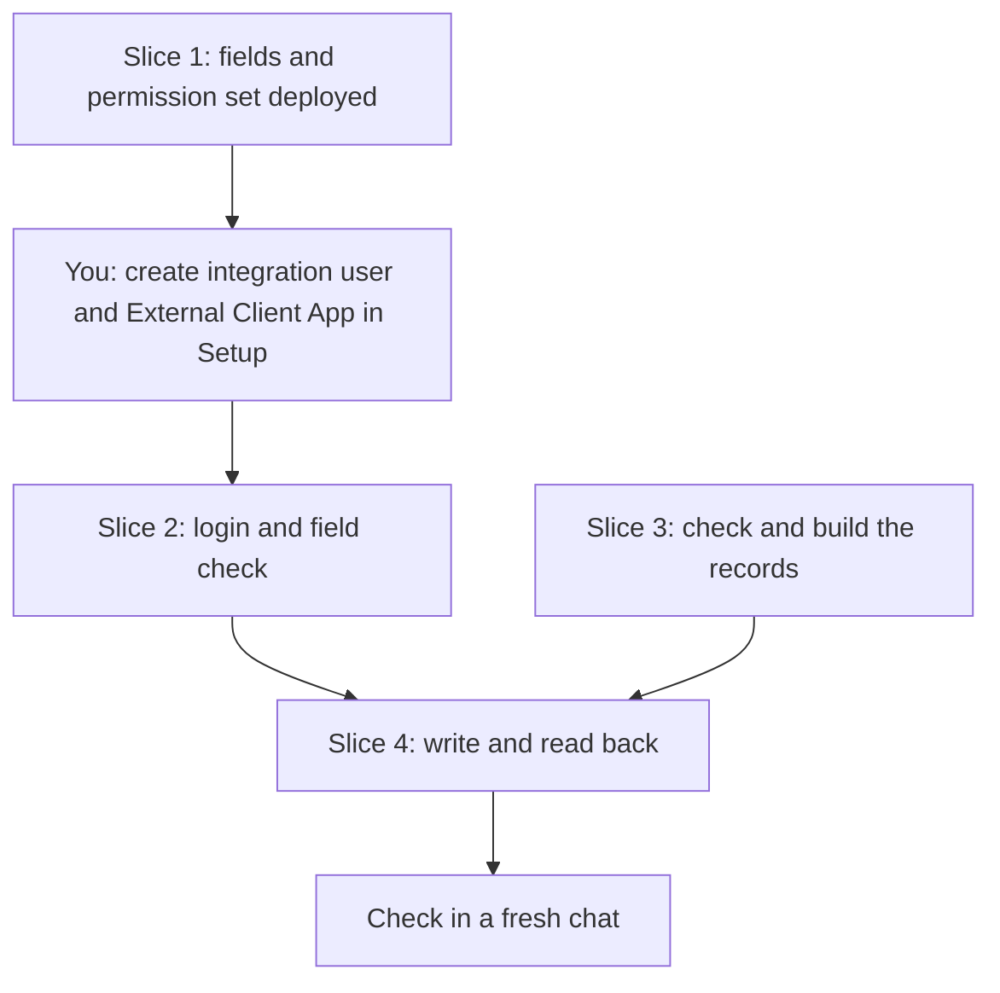

# Salesforce write-back plan

Status: proposed, awaiting approval. Source of agreement: [SPEC.md](../../SPEC.md) (Salesforce fields, write-back rules, secrets) and the choices made in chat on 2026-11-14: fields as files deployed with the Salesforce CLI, and login through an External Client App.

## Goal

Take the 300 scores the local engine produces and write them into the Developer org, following the six write-back rules in the spec. It serves a BDR who opens Salesforce and sees a score, tier and reasons on each account. This plan ends with the write-back working from a laptop. The scheduled GitHub run and the dashboard are separate plans, because the schedule needs the code pushed to GitHub.

## What was checked before writing this plan

Read from the org on 2026-11-14, without changing it:

- Developer Edition, API version 68.0, nickname `scoring-dev`, 0 accounts.
- No existing Account field clashes with the eight names. Only Name is required to create an account.
- One unused **Salesforce Integration** licence, with the profile **Minimum Access - API Only Integrations**, and one unused **Salesforce API Integration** permission set licence.
- 15,000 API requests a day and 5 MB of data storage. A run uses about 5 requests.

Researched by three agents and challenged by three checkers. The automated tools could not open Salesforce's own help pages (they returned errors), so the facts below marked "test in the org" rest on search summaries and are proven by a real test in the org, not by a citation.

## Design choices

| Choice | Decision | Why |
| --- | --- | --- |
| Login | External Client App with the client credentials flow, created by hand in Setup | Password login is being retired and new connected apps are switched off. One app in one org is a ten-minute click path; keeping it as files would put a secret near the repo. |
| Who the engine logs in as | A new integration user on the Salesforce Integration licence, not your admin user | The engine gets only what it needs: read, create and edit on Account, and the eight fields. It cannot delete accounts, which backs up write-back rule 3. |
| Permissions | One permission set, `Scoring_Engine`, kept as a file and deployed with the fields | A new custom field is invisible to a user until a permission grants it. |
| Python libraries | `requests` to call Salesforce and `python-dotenv` to read the `.env` file, both pinned | The calls stay visible and explainable. A Salesforce helper library would add five dependencies and still not give the all-or-nothing rule. |
| The write call | sObject Collections upsert, matched on Sample Id, 200 records per request | It is the standard way to update-or-create many records by an outside id. |
| First load or later run | Before writing, ask Salesforce which Sample Ids already exist. New accounts get all fields; existing accounts get only Score, Tier, Top Reasons and Last Scored. | Rule 2: Segment, BDR and Region are never overwritten after the first load. A left-out field stays as it is; a blank value would wipe it, so the fields are left out. |
| Read-back | One whole-second UTC time for the run, then count the accounts carrying that time and require exactly the number sent | Rule 5. Whole seconds avoid a mismatch between what was sent and what Salesforce stores. |

### The all-or-nothing gap

Rule 4 says: check every record first, and if any record is bad, write nothing. The program does that check itself before any write, which meets the rule as written.

A second risk remains. Salesforce takes at most 200 records per request, so 300 need two requests, and each request is all-or-nothing only by itself. If Salesforce rejected something in the second request, the first 200 would already be saved.

Slice 4 tests one fix in the org: wrap both requests in a single Composite request with all-or-nothing on. Salesforce's documentation suggests this rolls back as one unit, but nothing found states it outright. If the test shows it does roll back, the program uses it. If not, the program uses two requests, reports the partial write loudly through the read-back, and SPEC.md gets an open item for you to decide. Either way a rerun is safe, because upserts create no duplicates.

## Slices

| # | Slice | Files and org changes | Change | Acceptance check | Blocked by |
| --- | --- | --- | --- | --- | --- |
| 1 | Fields and permission set | `sfdx-project.json`, `force-app/main/default/objects/Account/fields/` (8 files), `force-app/main/default/permissionsets/Scoring_Engine.permissionset-meta.xml`, `.gitignore` (adds `.sf/`, `.sfdx/`). Org: 8 fields and 1 permission set created. | The eight fields as files: Sample Id (text, external id, unique), Score (whole number), Tier, Segment and Region (restricted picklists), Top Reasons (long text), Last Scored (date/time), BDR (text). The permission set grants read, create and edit on Account and read and edit on the eight fields. | A dry-run deploy reports success, then the real deploy reports success. Describing Account in the org lists all eight fields with the right types. The permission set is assigned to your admin user. | nothing |
| 2 | Login | `requirements.txt` (adds 2 pinned libraries), `.env.example`, `salesforce/__init__.py`, `salesforce/client.py`, `check_salesforce.py`, `tests/test_salesforce_client.py`. Org: 1 integration user and 1 External Client App, created by you in Setup with step-by-step instructions. | The program reads the org address, client id and secret from the environment, asks for a token, then confirms it can see and edit all eight fields as the integration user. | `python check_salesforce.py` prints the eight fields as found and writable and exits 0. With a wrong secret it exits non-zero with a plain message, and neither the secret nor the token appears in the output. Tests cover a rejected login and a missing field, using a stand-in for Salesforce. A fresh environment installs cleanly from `requirements.txt`. | 1 |
| 3 | Check and build the records | `salesforce/records.py`, `tests/test_salesforce_records.py` | Pure Python, no Salesforce call. Checks all records before any write (duplicate or missing id, missing name, tier, segment or region outside the allowed lists, score out of range, reasons too long) and builds the two record shapes: full for a new account, four fields for an existing one. The allowed values are read from `weights.yaml`. | Tests show: one bad record among 300 stops everything and names the record; a new account gets all fields; an existing account gets exactly four fields and no blank values; reasons are joined into one text. Each test is committed and seen failing before the code that passes it. | nothing |
| 4 | Write and read back | `write_back.py`, additions to `salesforce/client.py`, `tests/test_write_back.py`, SPEC.md (records the all-or-nothing result). Org: 300 accounts created, then updated. | Score all accounts, check them, ask which exist, write, check every record's result, read back the count, print scored, written and failed counts, exit non-zero on any failure. First the all-or-nothing test described above, on throwaway accounts that are deleted afterwards. | Spec acceptance 3: two runs in a row leave exactly 300 accounts with a Sample Id, no duplicates, all carrying the second run's time. Changing one account's Region by hand and rerunning leaves the change in place. A forced bad record makes the run exit non-zero with the org's scores unchanged. The throwaway accounts are gone. | 2, 3 |

Failing-test evidence: for every test in slices 2 to 4, the test is committed on its own before the code, and the failing output is saved in full (not cut short) in the scratch folder.

## Dependencies

| Dependency | Needed by | Exists now? | Provider | If missing |
| --- | --- | --- | --- | --- |
| Developer org, connected as `scoring-dev` | all slices | yes | you | not applicable |
| Salesforce CLI 2.158.7 | slice 1 | yes | installed 2026-11-14 | not applicable |
| Salesforce Integration licence | slice 2 | yes, 1 unused | the org | fall back to a standard licence user (2 unused) with the same permission set |
| Integration user | slice 2 | no | you, in Setup, with my instructions | slice 2 cannot run |
| External Client App with client credentials on | slice 2 | no | you, in Setup, with my instructions | slice 2 cannot run |
| `SF_INSTANCE_URL`, `SF_CLIENT_ID`, `SF_CLIENT_SECRET` in `.env` | slices 2 and 4 | no | you paste them into `.env` yourself; never into chat | the check exits with a message naming the missing variable |
| `requests` and `python-dotenv` | slices 2 and 4 | no | installed into `.venv` at pinned versions | slice 2 cannot run |

## Verification

| Requirement | Check | Runs now? |
| --- | --- | --- |
| Rule 1: upsert by Sample Id, no duplicates | Slice 4: two runs, then a count of accounts and of distinct Sample Ids, both 300 | after slice 4 |
| Rule 2: only engine fields after first load | Slice 3 tests on the record shapes; slice 4 hand-edited Region survives a rerun | after slices 3 and 4 |
| Rule 3: never delete or blank | The permission set has no delete on Account (checked by reading the file and in the org); slice 3 test that no blank values are sent | after slices 1 and 3 |
| Rule 4: all or nothing | Slice 3 test that one bad record stops the run before any write; slice 4 all-or-nothing test in the org | after slices 3 and 4 |
| Rule 5: read back | Slice 4: count equals 300; a test with a stand-in returning 299 makes the run fail | after slice 4 |
| Rule 6: fail loudly | Slices 2 and 4: non-zero exit and printed counts on each failure path | after slices 2 and 4 |
| Secrets never in code, commits or logs | A search of the repo and of saved run output for the secret and token; `.env` ignored by git | after slice 2 |

Spec acceptance 4 (a forced failure turns the GitHub run red), 5 (dashboard) and 6 (demo video) are outside this plan.

## Security

- **Worth protecting:** the client secret and the access token (they allow writing to the org), and the org's Account data.
- **Who can reach it:** anyone who can read the `.env` file, the repo history or a run's output.
- **What stops misuse:** the secret lives only in `.env`, which git ignores, under the name `SF_CLIENT_SECRET`; later it goes into GitHub Actions secrets. `.env.example` holds names only. The program never prints the secret, the token or the login header, and a slice 2 check searches the output for them. The integration user cannot delete accounts and can touch only Account and the eight fields. Every request has a time limit, and values from the scores file are checked for type and range before being sent. The Salesforce CLI's own saved login stays on your laptop and is never used by the program.

## Risks, open decisions and fog

- Risk: the Setup click path for the External Client App is confirmed only by third-party guides. Labels may differ on screen. I give the steps one screen at a time and you tell me what you see.
- Risk: a field's type is hard to change once it holds data. The eight definitions are shown to you in the dry run before the real deploy.
- Risk: a field the integration user cannot see is silently missing from reads. The slice 2 check tests every field as that user before any write code exists.
- Risk: a request that times out may still have been saved. The program never assumes; the read-back decides.
- Risk: Python 3.9 is past its end of support, so pinned libraries for it may miss security fixes. Moving to a newer Python is a separate small job, best done before the GitHub Actions plan.
- Fog: GitHub's runners use changing network addresses, and the org may restrict where a login can come from. Revisit in the GitHub Actions plan with a real run.
- Fog: free Developer orgs can be switched off after long inactivity. Revisit if the org is left unused.
- Open decision: none before the build. The all-or-nothing test in slice 4 may raise one.

## Flow

## Approval

Approving this plan authorizes: creating the branch `salesforce-write-back` from `local-scoring-engine`; writing the files in the four slices; installing `requests` and `python-dotenv` into `.venv`; deploying the eight fields and the permission set to the `scoring-dev` org; assigning the permission set; creating, updating and deleting test accounts and the 300 sample accounts in that org; and committing each finished slice on the branch.

It does not authorize: pushing, opening a pull request, merging, any GitHub Actions work, the dashboard, or changing anything in the org beyond the items listed above. The integration user and the External Client App are created by you.

## Amendments from the territory check plan (2026-11-14)

Approved with [territory-check.md](territory-check.md). Where this section and the text above disagree, this section wins.

- **Slice 1 deploys ten custom fields, not eight.** Territory Status (picklist) and Territory Note (text, 255 characters) are added, and the permission set grants both. A dry run of all 11 components passed on 2026-11-14 with the org unchanged.
- **Slice 3 was reworked by slice tc-3 of the territory plan.** A new account gets Name, BDR and the engine fields. An existing account gets only the engine fields: Score, Tier, Top Reasons, Last Scored, Segment, Region, Territory Status and Territory Note. Region is left out when it is unknown, and the note is sent even when empty.
- **Write-back rule 2 changed** to match: after the first load, Name and BDR are never overwritten. Segment and Region are no longer protected, because the engine now works them out.
- **Slice 4's rerun check changed.** The hand-edit that must survive a rerun is a changed BDR, not a changed Region.
- **Slices 2 and 4 check ten fields** where the text above says eight.

## Amendment: tests that start green (approved by the owner on 2026-11-14)

The plan says that for every test in slices 2 to 4, the test is committed before the code and seen failing. That rule is for tests of new behaviour. A test added for behaviour that already exists may start green, on two conditions:

1. The build record says so.
2. A negative control is recorded: the code is broken on purpose in a scratch copy, the test is seen failing there, and the real code is left untouched.

No failure is ever faked, and correct code is never broken in the repository to produce one. This is the same exception the territory check plan carries.

Tests this covers so far, each with its negative control:

| Test | Deliberate fault in a scratch copy | Result there |
| --- | --- | --- |
| `test_more_records_than_one_request_can_hold_stops_before_any_write` | The 1,000-record cap removed from `write_records` | Failed: the expected error was not raised |
| `test_no_accounts_at_all_is_a_failure_not_a_silent_success` | The "no accounts to write" check removed from `write_back` | Failed: the run crashed instead of reporting the failure |

## Amendment: a write that gets no answer (2026-11-14)

The plan said that when a write request times out, "the read-back decides". Two independent checks showed a count cannot decide that: accounts written by another run in the same second carry the same time and look identical. The behaviour is now:

- A run succeeds only when Salesforce answers the write with a clean success and the read back matches.
- Before writing, the engine counts the accounts that already carry the run's time and sends nothing unless that is zero.
- A write that gets no answer fails the run. The counts line says "written unknown" unless no account carries the run's time, in which case it says "written 0". The message says to run it again, which is safe because accounts are matched on their Sample Id.
