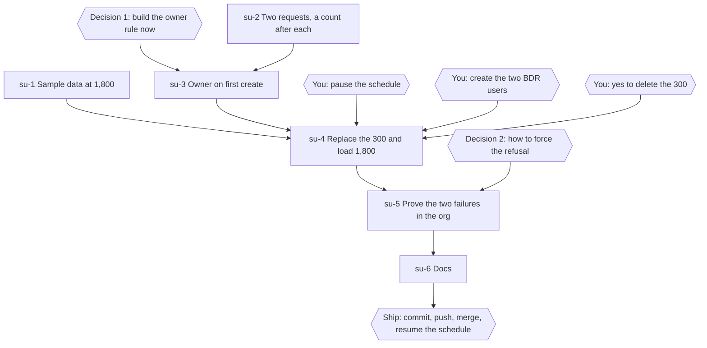

# Scale to 1,800 accounts plan

Status: approved by the owner on 2026-11-14 (see "Answers after approval" at the end). Source of agreement: [SPEC.md](../../SPEC.md): In scope, "Sample size and the limits of the demo org", write-back rules 4 and 5, Account ownership, the Decisions table, and open items 4, 5 and 8. The spec changes are on this branch (`spec-scale-and-dashboards`).

## Goal

Grow the sample from 300 accounts to 1,800 (60 BDRs with 30 accounts each), teach the write-back to send them as two all-or-nothing requests of up to 1,000 with a count after each, replace the 300 accounts now in the Developer org with the 1,800, and prove in the org what happens when Salesforce refuses the second request. It serves the demo: a team-sized book of accounts in Salesforce, with an honest account of what the engine does when a write only half succeeds.

Not in this plan: the two dashboards, the Platform licence test (open item 6), the manager "by BDR" view (open item 7) and the demo video. Those belong to the dashboards plan, which starts once the 1,800 accounts exist.

## What was checked before writing this plan

Read from the org on 2026-11-14 through the admin login, without changing anything:

- 300 accounts, all 300 with a Sample Id. 9 active users. Data storage shows 5 MB of 5 MB remaining (the figure is rounded to whole megabytes).
- 15,000 API requests a day. A run at 1,800 uses about 8.
- The `score-accounts` workflow is active on GitHub and its schedule is on `main`, so it writes the 300 accounts from `main` every weekday at 7:00 Eastern.

Read from the code:

- `write_back.py` sends everything in one request and stops with an error above 1,000 records (`salesforce/client.py`, `write_records`). The count before writing and the count after already exist; they run once each.
- `data/generate_sample.py` makes 5 accounts per BDR. The every-20th pattern is already there; the unknown-country accounts are a fixed list of three.
- Nothing in the engine sets an Account Owner today. The spec's ownership rule (set the owner once, when the account is first created) is not built.
- Changing 5 accounts per BDR to 30 changes every generated value, including the BDR names, because the names are drawn in sequence from one seeded source. That is fine: the 300 are being replaced.
- Checked by arithmetic against the agreed pattern: each BDR's 30 account numbers hold one or two multiples of 20; 90 moved accounts split 30 / 30 / 30 by size, region and both; numbers 50, 150, ... 1750 are 18 accounts and none is a multiple of 20. So 1,692 in territory, 90 outside, 18 not checked.

## Design choices

| Choice | Decision | Why |
| --- | --- | --- |
| Where the split happens | `write_back.py` cuts the records into requests of up to 1,000, in ranking order, and calls the existing `write_records` once per request | `write_records` already does one all-or-nothing request and checks every record's result. It stays as it is. |
| Counting | Count before the first request (must be 0), then after every request. The running total must equal the records sent so far: 1,000, then 1,800 | Write-back rule 5. |
| A refused request | Stop. Send nothing more. Count. If the count equals what the earlier requests saved, report it as written and the rest as failed | Rules 4 and 5: "if the second is refused, the first 1,000 are saved and the other 800 are not". |
| A request with no answer | Stop. Report the written count as unknown and say to run again | Rule 5, unchanged from today. |
| A count that is wrong after a clean success | Stop before the next request and fail. **Proposed, not agreed:** the spec says a wrong count fails the run but does not say whether the next request is still sent. Stopping keeps a doubtful run from writing more. | |
| Owner on first create | One extra read per run: the names of the active users. A new account whose BDR has the same name as exactly one active user is created with that user as owner. An existing account is never sent an owner. | SPEC.md, Account ownership. |
| Two active users with the same name as a BDR | Stop before writing and name the BDR. **Proposed, not agreed:** the spec does not cover it. Guessing an owner would be worse than stopping. | |
| The five-batch comment | Reworded to say both facts: Salesforce's guide says five batches in a request is the most; a test in this org on 2026-11-14 accepted six; the engine stays at five | Open item 8, settled. |
| Branch | Build on this branch, `spec-scale-and-dashboards` | The spec this plan builds from lives here. |

## What you do yourself

Each of these is asked for at its moment in the build, with step-by-step instructions. None is authorized by approving this plan.

1. Say yes to pausing the scheduled workflow, and later to switching it back on.
2. Create the two BDR users in Setup (if you agree to open decision 1). Their passwords never go in the repository or in chat.
3. Say yes to deleting the 300 accounts, at that moment, after seeing the snapshot.
4. Say yes to each commit beyond a slice's own, and to any push.

## Slices

Slice ids are `su-1` to `su-6`. Every test is committed and seen failing before the code that passes it, as in the earlier plans.

| # | Slice | Files and org changes | Change | Acceptance check | Blocked by |
| --- | --- | --- | --- | --- | --- |
| su-1 | Sample data at 1,800 | `data/generate_sample.py`, `data/accounts.json`, `data/bdrs.json`, new `tests/test_sample_data.py`, the data-dependent tests in `tests/test_salesforce_records.py` | 30 accounts per BDR. The unknown-country accounts become "every 100th counting from 50" instead of a list of three. Docstring numbers updated. | `python data/generate_sample.py` run twice leaves both files identical (`git diff --exit-code data/` after the second run). `python run_local.py` prints tier counts that add up to 1,800 and the territory line 1,692 / 90 / 18. Tests show: 60 BDRs with exactly 30 accounts each; every BDR has one or two accounts outside its territory; the 90 split 30 / 30 / 30; the 18 unknown-country accounts are numbers 50, 150, ... 1750; all 1,800 pass the record check. The Tier A and Tier B shares are printed and written down (the BDR dashboard relies on "about 4 in 100 are Tier A"). | nothing |
| su-2 | Two requests, a count after each | `write_back.py`, `salesforce/client.py` (one constant and the comment), `tests/test_write_back.py` | The split, the running count and the new failure report described under Design choices. The message for a refused later request says how many accounts were written and how many were not, and that a rerun is safe once the cause is fixed. | Against the stand-in for Salesforce: 1,800 accounts go as exactly two write requests (1,000 in five batches, then 800 in four) with three counts (0, 1,000, 1,800), ending `Scored 1800, written 1800, failed 0`. Second request refused: the run fails with `Scored 1800, written 1000, failed 800`, the first 1,000 stay saved, and a second run leaves all 1,800 with one time. First request refused: no second request is sent and nothing is saved. Second request gets no answer: written is reported as unknown, with the run-again advice. Count wrong after the first request: no second request is sent. A bad record caught by the engine's own check: no request at all. The existing tests for 1,000 records or fewer still pass with their wording unchanged, except the one test that expected more than 1,000 records to be an error, which is replaced. | nothing |
| su-3 | Owner on first create | `salesforce/client.py` (read the active users), `salesforce/records.py`, `write_back.py`, `check_salesforce.py`, their tests | The ownership rule from the spec. `check_salesforce.py` also confirms, read-only, that the engine's user can see the Account Owner field, may set it on create, and can read user names. | Against the stand-in: a new account whose BDR matches one active user is created with that owner; a new account with no match carries no owner; an existing account is never sent an owner, even when a matching user appears later; two active users with one BDR's name stop the run before any write. No user id, user name or login name appears in any printed line (marker tests, as in the scheduled-run plan). `python check_salesforce.py` against the real org prints the new lines and exits 0. | su-2 (same files), open decision 1 |
| su-4 | Replace the 300 and load 1,800 | No repo files. Org: schedule paused; two users created by you; 300 accounts deleted through the admin login; 1,800 created, then updated. A snapshot and the before and after reads are saved in `<scratch>`, outside the repository. | In order: pause the schedule; create the two users, named after two BDRs from different territories in the new roster; run `check_salesforce.py`; save a snapshot of the 300 (every engine field, Name, BDR and owner); you say yes; delete; confirm 0 accounts; run `python write_back.py`; run it again. | First run prints two requests' worth of work and ends `Scored 1800, written 1800, failed 0`. Second run ends the same, and the org then holds exactly 1,800 accounts with a Sample Id, 1,800 distinct Sample Ids, all carrying the second run's time (spec acceptance: two runs, no duplicates). Read through the admin login: each of the two real users owns exactly their 30 accounts and the engine's user owns the other 1,740. This is the proof open item 5 asks for. Data storage used is read and written down next to the spec's estimate of about 3.6 MB. The time each write request took is written down next to the 30-second limit. | su-1, su-2, su-3; your yes; the two users |
| su-5 | Prove the two failures in the org | No repo files. A proof script in `<scratch>`. Org: 1,000 accounts rewritten by the failed run, then all 1,800 by the rerun. | (a) Salesforce refuses the second request: the real `write_back` runs, and one record in the second request is changed on its way out to a tier the Tier picklist does not have, so the engine's own check passes and Salesforce itself refuses (open decision 2). (b) The engine's own check catches a bad record: `python write_back.py --accounts` on a copy of the 1,800 with one duplicated id. | (a) The run exits with an error and prints `Scored 1800, written 1000, failed 800`. A read of the org shows exactly 1,000 accounts with the failed run's time and 800 still with the earlier time. Running `python write_back.py` again leaves all 1,800 with one time. (b) The run exits with an error and "nothing was sent"; the before and after reads of all 1,800 are identical, byte for byte. | su-4 |
| su-6 | Say it in the docs | `README.md`, `CHANGELOG.md`, `docs/RELEASING.md` if it names 300 | The run steps and the Status line say 1,800. A short section says why the sample is 1,800, what the demo org limits (storage and logins) and how the design scales (requests of 1,000 now, Bulk API 2.0 on the roadmap). The changelog records what was proven. | Every new or changed statement points to a check in this plan that passed. No real address, id or user name appears. `pytest` passes. | su-4, su-5 |

### After the build

These are ship steps, not build steps, and each needs its own yes:

- Commit the spec changes, push, open the pull request, merge.
- Switch the schedule back on only after `main` holds the 1,800 accounts file. Then press the Run button once on `main`: a green run that ends `Scored 1800, written 1800, failed 0` closes this work. The Run button's "Force a failure" box at 1,800 is the spec's sixth acceptance item and is checked there too.

## Loop check

This plan adds no scheduled or repeating job. The existing weekday schedule keeps its trigger, scope and stop rules from the scheduled-run plan; only the size of its input changes. It is paused during the replacement (see Risks).

## Dependencies

| Dependency | Needed by | Exists now? | Provider | If missing |
| --- | --- | --- | --- | --- |
| Developer org, admin login as `scoring-dev`, Salesforce CLI 2.158.7 | su-3 to su-5 | yes, read on 2026-11-14 | you | not applicable |
| `SF_INSTANCE_URL`, `SF_CLIENT_ID`, `SF_CLIENT_SECRET` in `.env` | su-3 to su-5 | the `.env` file exists; values not read | you | the check exits naming the missing variable |
| Room for 1,800 accounts (about 3.6 MB of 5 MB) | su-4 | yes by the spec's estimate; the 300 are deleted first | the org | the first request is refused whole and nothing changes; you decide |
| Two spare user licences | su-4 | the spec says 8 spare; not re-read | the org | load without real owners (see open decision 1) |
| The two BDR users | su-4 | no | you, in Setup, with instructions | su-4 waits, or goes ahead without them if you choose that in open decision 1 |
| Your yes to delete the 300 | su-4 | no | you, at that moment | su-4 stops before the deletion |
| GitHub CLI, to pause and resume the schedule | su-4, ship | yes | you say yes; the command is run for you or by you | pause it in the GitHub Actions page instead |
| The engine's user may set an owner on create | su-4 | believed yes (open item 5); proven only by the first write | the org | Salesforce refuses the request whole, nothing is half-owned, and you decide |

## Verification

| Requirement (SPEC.md) | Check | Runs now? |
| --- | --- | --- |
| 1,800 accounts, 60 BDRs, 30 each; 90 outside, 18 unknown, every BDR has one or two | su-1 tests and `run_local.py` output | after su-1 |
| Acceptance 1: tier counts add up to 1,800; territory 1,692 / 90 / 18 | su-1, `python run_local.py` | after su-1 |
| Rule 4: requests of up to 1,000, in order, stop at the first failure | su-2 tests; su-5 (a) in the org | offline after su-2; org after su-4 |
| Rule 4: engine's own check finds a bad record, nothing written (acceptance 4) | su-2 test; su-5 (b) in the org | offline after su-2; org after su-4 |
| Rule 5: count before, and after each request: 1,000 then 1,800 | su-2 tests; su-4 first run | offline after su-2; org at su-4 |
| Rule 5: no answer means written unknown and run again | su-2 test (stand-in only; a lost connection cannot be forced honestly in the org) | after su-2 |
| Acceptance 3: two runs leave exactly 1,800, no duplicates | su-4 | at su-4 |
| Acceptance 5: second request refused, 1,000 written and 800 not, rerun leaves one time | su-5 (a) | after su-4 |
| Account ownership: owner set once on create, never changed | su-3 tests; su-4 owner read | offline after su-3; org at su-4 |
| Open item 4: snapshot, then deletion through the admin login with your yes | su-4 | at su-4 |
| Open item 5: the engine's user can set the owner | `check_salesforce.py` (su-3), then the first real write (su-4) | at su-4 |
| Open item 8: the comment says both facts | su-2, checked by reading | after su-2 |
| The demo says why 1,800, the limits and how it scales | su-6 text; the video itself is outside this plan | after su-5 |
| Acceptance 6: forced failure on GitHub at 1,800 | ship step, after merge | not until merged |

## Security

- **Worth protecting:** the three Salesforce credentials; the org's address, record ids and user names (the repository and its logs are public); the accounts in the org, which this plan deletes once on purpose; the two new logins.
- **Who can reach it:** the engine's user through the API, the admin login on this laptop, and anyone reading a GitHub log.
- **What stops misuse:** credentials stay in `.env` and GitHub secrets, unchanged. The engine now reads user names and ids to set owners; they travel only inside the request and never reach a printed line, and su-3's marker tests fail if one does. The deletion is done through the admin login with your yes at that moment; the `Scoring_Engine` permission set is not changed, so the engine still cannot delete. The snapshot and the org reads hold Salesforce ids, so they are kept in `<scratch>` and never copied into the repository. The proof script that tampers with a request also lives in `<scratch>`, so no workflow can run it. The two new users carry generated sample names, get the lowest licence that works, and their passwords are set by you and never written down here.

## Risks, open decisions and fog

- **Open decision 1 (needs you): does this plan build the owner rule and wait for the two users before the first load?** Recommended: yes (that is su-3 and the user step in su-4). The owner is set only when an account is first created, so if the 1,800 are loaded before the two users exist, their 60 accounts belong to the engine's user for good, and fixing it means changing 60 owners by hand or deleting and reloading. Open item 5 also cannot be proven without it. The users can start on Platform licences; whether a Platform user can open the dashboard (open item 6) is still tested in the dashboards plan, and a licence change later keeps the same user and the same accounts. The alternative: drop su-3, load now, and hand the ownership problem to the dashboards plan.
- **Open decision 2 (needs you): how to make Salesforce refuse the second request for real.** Recommended: the scratch script in su-5, which changes one record on its way out. Nothing in the org's setup changes and there is nothing to forget to remove. The alternative is a temporary validation rule in the org that rejects one named account: it lets the untouched command line run, but it is a setup change that breaks every run until it is removed.
- **Two "proposed, not agreed" behaviours** in Design choices: stop before the next request when a count is wrong, and stop the run when two active users share a BDR's name. Approving the plan agrees them; the spec then needs one sentence for each, which is yours to approve.
- Risk: the weekday schedule runs from `main` with the old 300-account file. If it fires after the deletion and before the load, it recreates 300 old accounts whose Name and BDR can then never be corrected. If it fires after the load, it overwrites 300 accounts' scores with the old data until the next full run. -> The schedule is paused before the deletion and stays paused until `main` holds the new file. The next scheduled run is Monday at 7:00 Eastern.
- Risk: a request of 1,000 records may take longer than the engine's 30-second limit; the largest request so far held 300. -> A slow request fails safely as "no answer", and su-4 writes down the real time. If it is close, raising the limit is a one-line change you are asked about.
- Risk: the deleted 300 sit in Salesforce's recycle bin for 15 days, and the new accounts reuse 300 of their Sample Ids. If Salesforce counts binned records against the unique Sample Id, the first request is refused whole and nothing changes. -> Then the bin is emptied, with your yes, because that makes the deletion final. The snapshot and the old data file in git history remain.
- Risk: the storage figure of about 2 KB an account is Salesforce's rule of thumb. -> su-4 reads the real figure after the load.
- Risk: between the two requests, and after a refused second request, Salesforce holds a mix of two runs' scores. -> Accepted in the spec; the run fails loudly and a rerun fixes it. su-5 leaves the org in that state only until its own rerun.
- Risk: the spec this plan builds from is uncommitted. -> It is committed with this plan, with your yes, before the build starts, so an independent check in a fresh chat can read it.
- Fog: whether a Platform licence can open the BDR dashboard (open item 6); revisit in the dashboards plan.
- Fog: what "by BDR" shows on the manager dashboard (open item 7); revisit once su-4 is done.
- Fog: Bulk API 2.0 and scoring accounts read from Salesforce; on the roadmap, revisit after v0.1.

## Flow

## Approval

Approving this plan authorizes building su-1 to su-6 on this branch, with a commit per finished slice and its build record, and it settles open decisions 1 and 2 and the two proposed behaviours as you answer them.

It does not authorize, and each still needs your yes at its moment: pausing or resuming the schedule, creating users, deleting the 300 accounts, emptying the recycle bin, editing SPEC.md, pushing, opening a pull request or merging. The dashboards and the demo video stay outside this plan.

## Answers after approval

Given by the owner in chat on 2026-11-14. The plan above is left as it was approved.

- **Open decision 1: yes.** The owner rule is built in this plan (su-3), and the two BDR users are created before the first load.
- **Open decision 2: not answered yet.** It is needed before su-5.
- **A change found in su-2, accepted.** The plan said a second request that gets no answer reports the written count as unknown. As built, there are two cases. If the count has not moved from 1,000, the engine reports 1,000 written and 800 not written, with the advice to run again; this is how a single request with no answer and a count of zero was already reported as "written 0". If the count has moved, the engine reports unknown. Write-back rule 5 in SPEC.md says "unknown" without telling the two cases apart, so the spec needs one sentence, which is the owner's to approve.
- **An exception to "seen failing first", approved by the owner.** The Slices section says every test is committed and seen failing before the code that passes it. An independent check of su-1 and su-2 found three new tests that already passed when they were written, because each guards behaviour that existed before this plan: `test_roster_has_3_bdrs_for_each_segment_in_each_region` and `test_saved_files_are_exactly_what_the_generator_makes` in `tests/test_sample_data.py`, and `test_one_bad_record_among_1800_caught_by_the_engines_own_check_sends_nothing` in `tests/test_write_back.py`. The owner approved keeping them as guards without a failing run of their own. The reason: the checker's negative controls show each one fails when the thing it guards is broken (bad roster or data input for the first two; the record check switched off for the third). The rule still applies to every other test in this plan.
- **Write-back rule 5 in SPEC.md now states the two no-answer cases**, with the owner's approval, so the spec and the engine agree.
- **The exception extended to four tests in su-3, approved by the owner.** These four passed before the owner rule was written, because code that sets no owner already satisfies a test that says "no owner is sent": `test_new_account_with_no_matching_user_carries_no_owner` and `test_existing_account_is_never_sent_an_owner` in `tests/test_salesforce_records.py`, and `test_existing_account_is_never_sent_an_owner_even_when_a_matching_user_appears_later` and `test_program_hides_an_owner_id_that_salesforce_repeats_in_a_refusal` in `tests/test_write_back.py`. The owner approved keeping them without a failing run of their own. The reason: the builder's broken copies and the checker's own mutations both make all four fail when the behaviour is broken. The rule still applies to every other test in this plan.
- **The two real BDR users** for su-4 are the BDRs named Danielle Johnson (SMB, North America) and Debra Mullen (Enterprise, EMEA) in `data/bdrs.json`, confirmed by the owner. Both are generated sample names.
