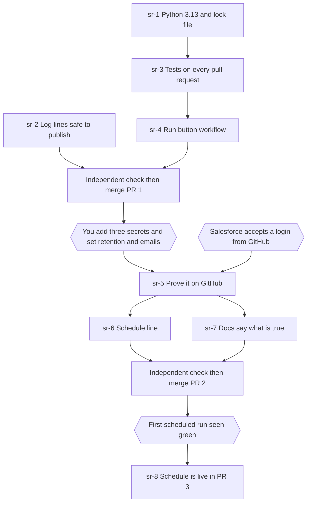

# Scheduled run plan

Status: approved by the owner in chat on 2026-11-14, with the recommended answer on all nine open decisions and SPEC.md changes 1 to 4. Source of agreement: [SPEC.md](../../SPEC.md) (Schedule, Secrets, write-back rule 6 and acceptance item 4), the handoff of 2026-11-14, and the choice made in chat on 2026-11-14 to plan the GitHub Action first with the move off Python 3.9 inside it.

## Goal

GitHub starts the scoring engine by itself on weekdays at 7:00 AM Eastern, and a Run button starts it on demand. Both run the same script, `write_back.py`. Any failure shows red on GitHub. A failure before the write, or a write that Salesforce refuses, leaves the scores as they were. It serves a BDR who opens Salesforce in the morning and finds fresh scores, and a reader of the repo who can see the run history. This plan closes spec acceptance item 4. The dashboard and the demo video are separate plans.

One limit carried over from the write-back design: if a write is sent and Salesforce never answers, or the read back finds the wrong count, the run is red but the scores may have changed. The engine says so and says to run it again, which is safe.

## Terms used in this plan

| Term | Meaning |
| --- | --- |
| Workflow | A file in `.github/workflows/` that tells GitHub what to run and when. |
| Runner | The temporary computer GitHub lends to a workflow for one run. It is wiped afterwards. |
| Repository secret | A value GitHub stores encrypted and hands to a workflow as an environment variable. Nobody can read it back, including you. |
| Commit id (40 characters) | The exact fingerprint of one version of some code. A version tag such as `v7` can be moved to different code later; a commit id cannot. "Pinning" means naming the commit id. |
| Lock file and checksum | A generated list of every library the project installs, each with a fingerprint of the file. The installer refuses any file whose fingerprint differs. |
| Fork | Someone else's copy of a public repo. They can send changes back as a pull request. |
| `pull_request_target` | A workflow trigger that gives a fork's pull request access to secrets. It is a well-known way to leak them, so this plan bans it. |
| Traceback | The block of text Python prints when it crashes on an error nobody handled: file names, line numbers and the error message. |
| LibreSSL warning | The warning printed on every run today, because the Python 3.9 on this Mac uses an old encryption library. It goes away with the Python move. |
| Dependabot | A GitHub feature that opens pull requests proposing newer versions of pinned libraries and actions. |

## What was checked before writing this plan

In the repository and on this laptop, 2026-11-14, without changing anything:

- `main` is at `c0e52c4`, level with GitHub, 185 tests pass, the org check passes and the org holds 300 scored accounts.
- No `.github/` folder exists. The `.env` file holds exactly three names, `SF_INSTANCE_URL`, `SF_CLIENT_ID` and `SF_CLIENT_SECRET` (names read, values not).
- Python 3.13.14, 3.12.13 and 3.11.15 are already on this laptop, installed through `uv` 0.11.29 (a tool that manages Python versions and libraries). The project's `.venv` is Python 3.9.6. The GitHub command line tool `gh` is installed and logged in.
- The code uses nothing that behaves differently on newer Python (checked by reading: no removed modules, no reliance on set order, no warnings-as-errors).
- Every network error in `salesforce/client.py` is caught and reported by its type only. The org address is printed at `client.py` lines 75 and 102 and `check_salesforce.py` line 21. Raw Salesforce replies are printed at `client.py` lines 107, 160, 227 and 288.

Researched by four agents and challenged by four skeptics, from GitHub's, Python's and PyPI's own pages. The draft of this plan was then reviewed against the code by three more agents. All of that is helper review started from this chat, not an independent check.

| Fact | Status | What it changes |
| --- | --- | --- |
| A schedule entry can carry a time zone (`timezone: "America/New_York"`), added in March 2026. Without it the time is UTC. | confirmed on the docs and the changelog | One schedule line gives 7:00 AM Eastern all year. The handoff's "drifts by an hour" note is out of date. |
| Scheduled runs can start late, mostly at the top of the hour, and under heavy load can be dropped. No maximum delay is documented. | confirmed | The README must not promise exactly 7:00. The Run button is the recovery path. |
| Scheduled runs use only the workflow file on `main`. The Run button also needs the file on `main` first. After that, `gh workflow run --ref <branch>` runs a branch's version. | confirmed | The work needs more than one pull request (see Slices). |
| In a public repository, scheduled workflows are switched off after 60 days with no repository activity. Private repositories are not mentioned. | confirmed for public; private not documented | Matters once the repo is public. Goes into the release checklist. |
| Failure emails for a scheduled run go to whoever last edited the schedule line, if Actions notifications are set to Email. | confirmed | You push the schedule commit yourself and turn the setting on. |
| Run logs of a public repository can be read by anyone with a GitHub account. Making a private repo public exposes its old run logs too. | confirmed | Every log line must be safe to publish (slice sr-2). |
| GitHub replaces a secret's exact value with `***` in logs, but says this is "not guaranteed". A value the code has trimmed or reshaped may not be caught. | confirmed | The engine must not print the org address at all, instead of relying on hiding. |
| GitHub's runners change network addresses weekly, and GitHub advises against allow lists. | confirmed | If the org limits where logins come from, the fix is on the Salesforce side. |
| Python 3.9 and 3.10 are past end of support. 3.13 gets security fixes until 2029. All five pinned libraries declare support for 3.13; Faker and python-dotenv at the pinned versions do not declare 3.14. | confirmed | Move to 3.13. |
| Three pinned libraries have a published security advisory fixed only in versions that need Python 3.10 or newer: `requests` (fixed in 2.33.0), `pytest` (9.0.3) and `python-dotenv` (1.2.2). The `requests` advisory says normal use is not affected. | confirmed | Raise the three in the same slice as the Python move (open decision 6). |
| `actions/checkout` v7.0.1 is commit `3d3c42e5aac5ba805825da76410c181273ba90b1`; `actions/setup-python` v7.1.0 is commit `6d4fd22b20465ccc0f7354476588e8df7c9ca0e0`. Older versions built on Node 20 no longer run. | confirmed by listing the tags | Pin both by commit id. Re-check the ids at build time. |
| `actions/setup-python` reads `.python-version` only when the workflow names it with `python-version-file`. | confirmed | Both workflows name it, and a test checks that. |
| A private repo on the Free plan includes about 2,000 Linux minutes a month. Public repos run free. | confirmed | One run of about a minute each weekday is around 22 minutes a month. |

Not verifiable from here, so each is proven by a real run or by you in a browser:

- Whether the org blocks a login from GitHub's addresses. Salesforce's help pages would not load for the agents. Slice sr-5 tests it for real.
- How long a Developer org may sit unused before Salesforce switches it off, and whether an API login counts as use. Sources disagree (14 days, 45 days, 180 days).
- Whether seeded sample data comes out identical on Python 3.13. Slice sr-1 tests it.

## Design choices

| Choice | Decision | Why |
| --- | --- | --- |
| Python version | 3.13, named once in a `.python-version` file. `uv` reads it on the laptop; both workflows are told to read it. | The newest version all five libraries declare. One file means the laptop and GitHub cannot drift apart. |
| Installing libraries | From a lock file, `requirements.lock`, with checksums enforced. Generated with `uv pip compile requirements.txt --generate-hashes --universal --python-version 3.13`. | Today only the five are pinned. The libraries they pull in, such as `urllib3`, float. A job that holds Salesforce credentials should not install whatever was published this morning. `--universal` makes one file that works on the Mac and on GitHub's Linux. `requirements.txt` stays the short readable list. |
| Schedule | `cron: '0 7 * * 1-5'` with `timezone: "America/New_York"` | Matches the spec as written. |
| Workflows | Two files. `tests.yml` runs the tests on every pull request and push to `main`, with no secrets. `score-accounts.yml` is the scheduled run and the Run button. | The tests never need credentials, so they never get them. A pull request shows a green or red check. |
| Steps of the scheduled run | Check out, set up Python, install from the lock file, `check_salesforce.py` (reads only), then `write_back.py` | The read-only check fails first if the login or a field is broken, before anything is written. A normal run makes 7 Salesforce requests. |
| Where the secrets go | Three repository secrets, handed only to the two steps that talk to Salesforce | The install step runs other people's code and gets no credentials. |
| Forcing a failure | A tick box on the Run button, "Force a failure". When ticked, that run feeds the engine a small committed file of accounts with a duplicate id, through a new option `python write_back.py --accounts <file>`. | The run logs in for real, the engine's own check finds the bad record, sends nothing and exits with an error. That shows write-back rules 4 and 6 working on GitHub. The tick box is yes or no and picks between two fixed file names, so nothing a person types reaches a command. |
| Runs at the same time | One at a time. A second waits; GitHub keeps only one waiting, so a third replaces the second. | Two runs in the same second would trip the read back. Dropping an extra waiting run is harmless because every run does the same work. |
| Time limit | 10 minutes for the job; each request already gives up after 30 seconds | A run takes about a minute. A stuck run must not burn the allowance. |
| Retries | None. A red run waits for a person to press Run. | A rerun is safe, but a failure that repeats needs someone to read it. |
| Actions used | Only `actions/checkout` and `actions/setup-python`, pinned by commit id, on `ubuntu-24.04` | Naming the system version stops it changing under the job. |

## Slices

Workstream `scheduled-run`. Tests come first and are seen failing, with the same two amendments the earlier plans carry (a test of behaviour that is already correct may start green with a recorded negative control). Each slice gets its row in `docs/agents/build.md`; the independent check of each pull request writes `docs/agents/checks.md`.

Before you push any of the three branches, I scan every commit on it, not only the last, for local paths, the local username, the org's address and ids, user names and credentials, and report the result. Run logs and query results are kept outside the repository; the build records quote only counts and links to runs.

| # | Slice | Files and other changes | Change | Acceptance check | Blocked by |
| --- | --- | --- | --- | --- | --- |
| sr-1 | Move to Python 3.13 | `.python-version`, `requirements.txt` (three versions raised), `requirements.lock` (new), `README.md` (quickstart setup line). On this laptop: `.venv` rebuilt on 3.13. | Python 3.13. `requests`, `pytest` and `python-dotenv` raised to the newest release that carries the security fix. Faker and PyYAML stay as they are. The lock file is generated as in Design choices, and the `uv` version used is written in the build record. | In a brand-new environment built only with `pip install --require-hashes -r requirements.lock`: all 185 tests pass with no LibreSSL warning; after `python data/generate_sample.py`, `git diff --exit-code data/` reports no change to either data file; `python run_local.py` prints 282 / 15 / 3. Proof that the lock file also installs on Linux comes with sr-3's green check. | nothing |
| sr-2 | Log lines safe to publish | `salesforce/client.py`, `check_salesforce.py`, `write_back.py`, `tests/test_salesforce_client.py`, `tests/test_write_back.py`, `tests/test_check_salesforce.py` (new) | One shared clean-up step that every message built from a Salesforce reply or a network error passes through. It removes web addresses, Salesforce ids (15 or 18 characters), email-style user names and the three settings, strips a leading `::` (which GitHub would read as a command), and caps the length. Messages keep the HTTP status and the existing "CODE: message" and "Sample Id: message" wording. Whole replies are no longer printed. `check_salesforce.py` prints "Logged in." without the address. If open decision 1 is accepted in full, both scripts also get a last line of defence: an error nobody expected prints only its type, and the run still ends red. | New tests make the stand-in Salesforce answer, on every failure path, with a marker address, a marker record id and a marker user name, including inside the error text itself, and make the network raise errors whose text holds the marker address. The markers never appear in any message or printed line. A first test of `check_salesforce.py`'s output shows no address. Each new test is seen failing first. The earlier tests still pass with their wording unchanged. | nothing |
| sr-3 | Tests on every pull request | `.github/workflows/tests.yml`, `tests/test_workflows.py` | The workflow installs from the lock file with checksums enforced and runs `pytest`. `tests/test_workflows.py` reads every workflow file and fails if: an action is not pinned to a 40-character commit id; the permissions line is missing or wider than read; a `pull_request_target` trigger appears; a secret is named in `tests.yml`; Python is not read from `.python-version`; the install step does not enforce checksums; the checkout step leaves the job's GitHub token behind. | Locally: the workflow tests pass, and each rule is seen failing against a scratch copy that breaks it (a tag instead of a commit id, a missing permissions line, an added `pull_request_target`). On GitHub: the pull request shows the `tests` check green, which also proves the lock file installs on Linux. | sr-1 |
| sr-4 | The Run button | `.github/workflows/score-accounts.yml`, `write_back.py` (the `--accounts` option), `tests/fixtures/forced_failure_accounts.json`, additions to `tests/test_workflows.py` and `tests/test_write_back.py` | Manual trigger only, with the "Force a failure" tick box. Steps, secrets, one-at-a-time rule and time limit as in Design choices. No schedule yet. | Locally: `python write_back.py --accounts tests/fixtures/forced_failure_accounts.json` against the stand-in ends with "WRITE-BACK FAILED", names the duplicate id and sends no write (test seen failing first). Workflow tests show the secrets appear only on the two Salesforce steps, the tick box is used only to choose between the two fixed file names and never inside a command, the time limit and one-at-a-time rule are set, and the only trigger is the manual one. Its real check is sr-5. | sr-1, sr-3 |
| | **Pull request 1** (sr-1 to sr-4), independent check, then your merge | | | | |
| sr-5 | Prove it on GitHub | No code. You: add the three secrets, set log retention, turn on failure emails, press Run. Evidence saved in the outputs folder, outside the repo. | Three runs from the Run button. Before and after each, a read-only query through the Salesforce command line tool saves all 300 accounts' eight engine fields to a file. | (a) Normal run: green; the log shows "Scored 300, written 300, failed 0"; all 300 accounts carry one new Last Scored time and the other seven fields are identical to before. (b) "Force a failure" ticked: red; the log shows "WRITE-BACK FAILED" and "nothing was sent"; the before and after files are identical, byte for byte. This is spec acceptance item 4. (c) Normal run again: green, still exactly 300 accounts. (d) Log check on all three downloaded logs: no `***` anywhere in the output of the two Salesforce steps (a `***` would mean the code printed a secret that GitHub then hid), and no Salesforce record id, org id, email-style name, web address other than GitHub's and PyPI's, "Bearer" or "access_token". This search cannot see a value GitHub hid, which is why the `***` rule is there. | pull request 1 merged; the three secrets set by you |
| sr-6 | Turn on the schedule | `.github/workflows/score-accounts.yml` (schedule added), `tests/test_workflows.py` | The weekday 7:00 AM Eastern schedule line with its time zone. | Locally: a test reads the schedule line and its time zone, and the "only trigger" test from sr-4 is updated to allow exactly these two. On GitHub, on the first weekday after merging: a run appears marked as started by the schedule, it is green, the org's Last Scored time is that run's, and the start time is written down next to 7:00. | sr-5 |
| sr-7 | Say what is true | `README.md`, `CHANGELOG.md`, `docs/RELEASING.md`, `SPEC.md`, `docs/agents/status.md` | README: how the scheduled run and the Run button work, how to set the three secrets (with `gh secret set NAME`, pasting the value at the prompt, never inside the command), how to switch the schedule off, and a Status line saying the Run button is proven and the schedule is merged but not yet seen running. CHANGELOG: the Run button, the forced failure, the safer log lines and the Python move under `[Unreleased]`. RELEASING: a "before making the repo public" list and a monthly look at the pinned versions while the schedule is on. SPEC: the changes listed below. `status.md`: this workstream's line. | Every statement in the changed text points to a check in this plan that has passed. The README does not promise an exact start time and shows no real address or id. | sr-5 |
| | **Pull request 2** (sr-6 and sr-7), independent check, then your merge | | | | |
| sr-8 | The schedule is live | `README.md` (Status line), `CHANGELOG.md` (one line) | After the first scheduled run has been seen green: the Status line and the changelog say the schedule runs. | The run from sr-6 is linked in the build record. | first scheduled run observed |
| | **Pull request 3** (sr-8 only, a few lines), then your merge | | | | |

Why three pull requests: GitHub only shows the Run button, and only runs a schedule, for a workflow file that is already on `main`. So the Run button has to be merged before it can be pressed, and the schedule has to be merged before it can fire. The changelog rule ("only list an item once it's built and checked") then pushes the last two lines into a third, tiny one.

sr-1 and sr-2 do not depend on each other. sr-2 must be in pull request 1 so that the first real run (sr-5) already has the safe log lines.

If sr-5 finds a problem, the fix is made on a new branch and tested from that branch with `gh workflow run --ref <branch>` before it joins pull request 2.

The "before making the repo public" list in sr-7: delete every run made while the repo was private; read one fresh log; scan the whole history and the text of all pull requests; set fork pull requests to need approval and the default token to read-only; note the 60-day rule and that `gh workflow enable` switches the schedule back on.

### Proposed changes to SPEC.md (need your approval with this plan)

1. **Schedule**, add: "The start can be a few minutes late, because GitHub queues scheduled runs. The time zone is set in the workflow, so daylight saving needs no change."
2. **Secrets**, add: "On GitHub they are handed only to the steps that talk to Salesforce. Messages built from Salesforce replies are cleaned of addresses, ids and user names before they are printed, and whole replies are not printed." This reverses the earlier choice to leave replies alone (open decision 1).
3. **Done when, item 4**, becomes: "A forced failure (the Run button's 'Force a failure' box, which feeds the engine a file with a duplicate id) turns the GitHub run red and leaves the existing scores unchanged." This names one specific failure; the others stay covered by tests and the org tests of 2026-11-14.
4. **In scope for v0.1**, add: "Runs on Python 3.13, named in `.python-version`."
5. Only if open decision 4 later moves the time: the Schedule line changes from 7:00 to 6:47. I would ask again first.

## Loop check

This plan adds a job that repeats by itself, so the four questions apply.

| Question | Answer |
| --- | --- |
| Does it repeat often? | Yes, every weekday. |
| Can a check fail the work automatically? | Yes. The engine's own read back and exit code decide, and GitHub turns the run red. Neither is judged by the agent that built it. |
| Can the budget absorb retries? | Yes. About 1 minute a run and 22 runs a month against roughly 2,000 included minutes; 7 Salesforce requests a run against the org's daily allowance of 15,000 (read from the org on 2026-11-14). There are no automatic retries. |
| Can it see its own results? | Yes. The run log, the run history on GitHub, and the Last Scored time in Salesforce. |

Build order, as the loop check asks: done once by hand (the laptop runs of 2026-11-14), turned into a script (`write_back.py`), wrapped in a workflow with the Run button (sr-4, sr-5), scheduled last (sr-6).

- **Trigger:** the weekday schedule, or a person with write access pressing Run.
- **Scope:** the code limits each run to the 300 sample accounts, matched on Sample Id, and to the engine's eight fields (Region is left out when the country is unknown), plus Name and BDR when an account is first created. On the Salesforce side, the `Scoring_Engine` permission set lets the integration user read, create and edit accounts and the ten custom fields, and not delete. The user's profile is not in the repository and was not re-checked for this plan. The run changes nothing in the repository.
- **State:** no state file. Every run rescores all 300 accounts from the files in the repository, so there is nothing to resume. GitHub's run history is the record of which runs succeeded. The Last Scored time in Salesforce shows the last run that reached the write. There is no "do not retry" list because nothing retries.
- **Stop rules:** one attempt per trigger; 10 minutes at most; one run at a time. A failure ends that run. Before the write, or when Salesforce refuses the write, nothing is changed.
- **Progress test:** a run is done (green, 300 written) or stuck (red, with the reason in the log). These two rules are habits, not automation; nothing switches the schedule off by itself. You get the failure email, and you look at the Actions page each Monday. Two scheduled runs red in a row: switch the schedule off with `gh workflow disable score-accounts.yml` until the cause is fixed.
- **The check and who owns it:** the read back inside `write_back.py`, covered by tests and checked independently on 2026-11-14. It cannot notice a run that GitHub never started; the Monday look covers that.
- **Human approval:** the write to Salesforce is the scheduled action. It is limited to fields the engine owns and was agreed in the spec. Everything else (pushing, merging, changing secrets or org settings) stays with you.
- **How to judge it:** the share of scheduled runs that are green. Below about half over two weeks, fix it or turn it off.

One honest limit: the sample data does not change, so every run writes the same scores with a new time. The schedule proves the pipeline runs unattended; it produces new information only once v0.2 adds dated signals.

## Dependencies

| Dependency | Needed by | Exists now? | Provider | If missing |
| --- | --- | --- | --- | --- |
| Python 3.13 on this laptop | sr-1 | yes (3.13.14 through `uv`) | already installed | not applicable |
| `uv` to build the environment and the lock file | sr-1 | yes (0.11.29) | already installed | fall back to `pip-compile`, which would need installing and your yes |
| Newer `requests`, `pytest`, `python-dotenv` from PyPI | sr-1 | no | downloaded into `.venv` at pinned versions | sr-1 cannot run |
| `gh`, installed and logged in | sr-3 onwards | yes | already installed | I stop and say so |
| Salesforce command line tool connected as `scoring-dev` | sr-5 queries | yes (2.158.7) | already installed | sr-5 cannot prove "unchanged" |
| GitHub Actions switched on for the repo | sr-3 onwards | not checked; on by default | you, in the repo's settings | the pull request shows no check; I stop and say so |
| Pull request 1 merged to `main` | sr-5 | no | you | the Run button does not exist |
| `SF_INSTANCE_URL`, `SF_CLIENT_ID`, `SF_CLIENT_SECRET` as GitHub repository secrets | sr-5, sr-6 | no | you, from a terminal. Because `.env` holds exactly those three names, one command, `gh secret set -f .env`, uploads them without showing a value. Never pasted into chat. | the run fails at the first Salesforce step with "Missing setting(s)" |
| A login from GitHub's network accepted by the org | sr-5 | unknown | Salesforce; if blocked, you relax the IP setting on the External Client App in Setup | sr-5 (a) fails with a refused login; I stop, report the message and we decide |
| Log retention set to a short period; Actions failure emails set to Email | sr-5 | no | you, in GitHub settings, with my click path | logs are kept 90 days; no email on a red run |
| `scoring-dev` org alive | sr-5, sr-6 | yes today | Salesforce | runs go red; see Fog |

## Verification

| Requirement | Check | Runs now? |
| --- | --- | --- |
| Spec, Schedule: weekdays at 7:00 AM Eastern | sr-6 test on the schedule line; first scheduled run observed on GitHub | after pull request 2 is merged |
| Spec, Schedule: a manual Run button | sr-5 (a) | after pull request 1 is merged |
| Spec, Schedule: both run the same script | sr-4 and sr-6 tests: one job, one `write_back.py` step, whatever started it | after sr-4 |
| Spec acceptance 4: a forced failure turns the run red and leaves the scores unchanged | sr-5 (b): red run, and the before and after files of all eight fields on 300 accounts are identical | after pull request 1 is merged |
| Write-back rule 6: any failure shows red on GitHub | sr-5 (b) proves it for one failure, a bad record caught before writing. The other failure paths rest on the existing tests and the org tests of 2026-11-14; they are not rerun on GitHub. | after pull request 1 is merged |
| Spec acceptance 3 still holds from GitHub: exactly 300, no duplicates | sr-5 (a) and (c) | after pull request 1 is merged |
| Spec, Secrets: never in code or commits | sr-3 test (no secret in `tests.yml`), sr-4 test (secrets on two steps only), and the scan of every commit before each push | sr-3 and sr-4 locally |
| Spec, Secrets: never in logs | sr-2 marker tests are the main proof. sr-5 (d) is a second look at real logs, with the `***` rule. | sr-2 locally; sr-5 (d) after merge |
| Supported Python, same on laptop and GitHub | sr-1 fresh-environment check; sr-3 test on `.python-version`; sr-3 green check on GitHub | sr-1 locally |
| Sample data unchanged by the Python move | sr-1 generator check | sr-1 locally |

Not covered by this plan: spec acceptance 5 (dashboard) and 6 (demo video).

## Security

- **Worth protecting:** the client secret and client id (together they allow writing to the org as the integration user); the org's address and ids (your publishing rule keeps them out of anything public); the `main` branch, because the scheduled job runs whatever is on it.
- **Who can reach it:** anyone with write access to the repo can press Run, change the workflow, or run a branch's version of it with the real secrets. Today that is only you, and it should stay that way. Once the repo is public, anyone with a GitHub account can read the code and every run log, and can send a pull request from a fork. A library or action the job downloads runs inside the job.
- **What stops misuse:**
  - The secrets live in GitHub Actions repository secrets under the names `SF_INSTANCE_URL`, `SF_CLIENT_ID` and `SF_CLIENT_SECRET`, and are handed only to the two Salesforce steps. You set them yourself; they never pass through chat or a file in the repo.
  - Pull requests from forks get no secrets, and `tests.yml` names none. `pull_request_target` is banned by a test.
  - The integration user can read, create and edit accounts and the ten fields through its permission set, and cannot delete.
  - The job's own GitHub token is read-only, and the checkout does not leave it behind for later steps. Both are checked by a test.
  - Both actions are pinned to a commit id, and every library to a checksum. The lock file's change is shown to you in the pull request.
  - The Run button's tick box is a yes or no value that picks between two fixed file names. Nothing typed by a person is placed inside a command.
  - Log lines are cleaned of addresses, ids and user names (sr-2), proven by tests and looked at again on real logs in sr-5 (d). GitHub's hiding of secrets is a second layer, not the only one.
  - Before the repo is made public, the release checklist in sr-7 applies.
- **What the workflow tests are not:** they catch accidents. They do not stop a person with write access, who could change the workflow and the test together.
- **Still open after this plan:** the pinned actions and libraries go stale unless someone looks (open decision 5). If open decision 1 is taken only in part, an error nobody expected still prints a traceback, whose message could in principle hold a value from Salesforce.

## Risks, open decisions and fog

Open decisions. Each has my recommendation; approving the plan accepts the recommendation unless you say otherwise.

| # | Decision | Recommended | The alternative and what it costs |
| --- | --- | --- | --- |
| 1 | Reopen two points the handoff says were left alone on purpose: Salesforce replies are not cleaned, and there is no catch-all for unexpected errors. The new evidence is that run logs become public with the repo. | Do both in sr-2. | Clean the replies only: a crash nobody expected still prints a traceback. Or neither: delete logs by hand, and every future failed run shows the org address. |
| 2 | Lock file with checksums. | Yes. | Keep only the five pins: simpler, but the job installs whatever versions of the other libraries are newest that day. |
| 3 | How to force a failure. My first draft used a wrong secret; the review showed that fails at the login check and never reaches `write_back.py`, so it proves little. | The tick box that feeds the engine a file with a duplicate id. Adds one small option to the engine. | A wrong secret through the tick box: no change to the engine, but only shows that a refused login is red. |
| 4 | The minute. | 7:00 as the spec says, and write down how late the first week's runs start. If they are often more than 15 minutes late, or one is dropped, I ask you about moving to 6:47. | Start at 6:47 now so scores are ready by 7:00; changes the spec today. |
| 5 | Automatic update proposals (Dependabot) for the pinned actions and libraries. | Not in this plan. A monthly look goes into the release checklist. | Switch it on now: more pull requests to read, but a retired action cannot surprise the schedule. |
| 6 | Raise `requests`, `pytest` and `python-dotenv` with the Python move. You asked for the Python move only. | Yes: the fixes need the new Python anyway, and a scanner would flag the old versions on a public repo. `pytest` goes from version 8 to 9. | Move Python only: smaller change, known advisories stay. |
| 7 | A tests workflow on every pull request. Not required by the spec. | Yes: it is the proof that the lock file and Python 3.13 work on GitHub before any secret is involved. | Leave it out: the first proof on GitHub would be the run that holds the credentials. |
| 8 | The two stale lines in `docs/agents/status.md` belong to finished workstreams, and that file's rule is that each builder edits only its own line. | With your yes, I mark both as merged in sr-7. | Leave them; the file keeps saying work is in progress that is not. |
| 9 | The project has no `AGENTS.md` or `CLAUDE.md`, although your global rules say each project keeps one. | A separate small task, not this plan. | Add it here: more scope in an already long plan. |

Risks:

- Risk: the org refuses logins from GitHub's network. -> sr-5 tests it before the schedule exists; the fix is one setting on the External Client App, changed by you.
- Risk: the newer `pytest` changes how a test behaves. -> sr-1 runs all 185 on the new versions before anything else is built; if a test needs changing, I stop and show it instead of editing it to pass.
- Risk: the sample data comes out different on Python 3.13. -> sr-1 checks it byte for byte. If it differs, I stop: the committed data and the 300 accounts in the org would no longer match the generator, and that is your call.
- Risk: the clean-up step in sr-2 removes something needed to debug a failure. -> the status, Salesforce's error code and the Sample Id are kept; the same run on the laptop shows the same message.
- Risk: the time zone setting is eight months old. -> the first scheduled run is watched and its start time recorded (sr-6).
- Risk: a scheduled run is delayed or dropped by GitHub. -> the Run button; the README says "at or shortly after"; the Monday look.
- Risk: the org address is stored in GitHub with a trailing slash or space, so the form the code uses differs from the stored one and would not be hidden. -> sr-2 means the address is never printed, whatever its form.
- Risk: forgetting to delete private-period runs before going public. -> release checklist (sr-7), and short log retention set in sr-5.
- Risk: the schedule keeps running after the project is finished. -> the switch-off command is in the README.

Fog:

- Fog: Developer org expiry. Sources disagree on the period and on whether API logins count. Revisit: read Salesforce's "Developer Org Expiration" article in a browser before the demo, and log in to the org by hand now and then.
- Fog: the 60-day switch-off for quiet public repositories. Revisit when the repo is made public.
- Fog: rotating the client secret. No verified steps found. Revisit before the repo is made public.
- Fog: the v0.2 roadmap conflict noted in the handoff. Revisit when v0.2 is planned.

## Flow

## Approval

Approving this plan authorizes: creating a branch from `main` for each of the three pull requests; writing the files named in the slices; rebuilding `.venv` on Python 3.13 and downloading the pinned libraries into it; committing each finished slice and its build record on those branches; read-only queries against the `scoring-dev` org; saving run logs and query results in the outputs and scratch folders outside the repository; the first four SPEC.md changes listed above; and my recommendation on each open decision you do not change.

It does not authorize: pushing, opening a pull request, merging, setting or changing GitHub secrets or settings, pressing Run, changing anything in the Salesforce org or its setup, making the repo public, tagging a release, the dashboard or the demo video. Each of those is asked for when its moment comes. The secrets and the GitHub and Salesforce settings are changed by you.

## Amendment: where the first scheduled run is proven (approved by the owner on 2026-11-15)

The slice table gave sr-6 two acceptance checks: local tests on the schedule line, and the first scheduled run seen green on GitHub. The second can only happen after pull request 2 is merged, while the same table puts the independent check of sr-6 before that merge. An independent check found the contradiction. Where this section and the table above disagree, this section wins.

- **sr-6 acceptance is the local part only:** a test reads the schedule line and its time zone, and the "only trigger" test from sr-4 allows exactly the schedule and the Run button. This is the gate for merging pull request 2.
- **sr-8 acceptance carries the live proof, unchanged in substance:** on the first weekday after pull request 2 is merged, a run appears marked as started by the schedule, it is green, the org's Last Scored time is that run's, and the start time is written down next to 7:00. Only then do the README Status line and the changelog say the schedule runs.
- Nothing is dropped. Until sr-8 passes, the README keeps saying the schedule has not yet been seen running, and the changelog does not list it.
- If the first scheduled run fails or never starts, sr-8 stays open, the cause is fixed on a new branch, and the schedule can be switched off with `gh workflow disable score-accounts.yml` in the meantime.
