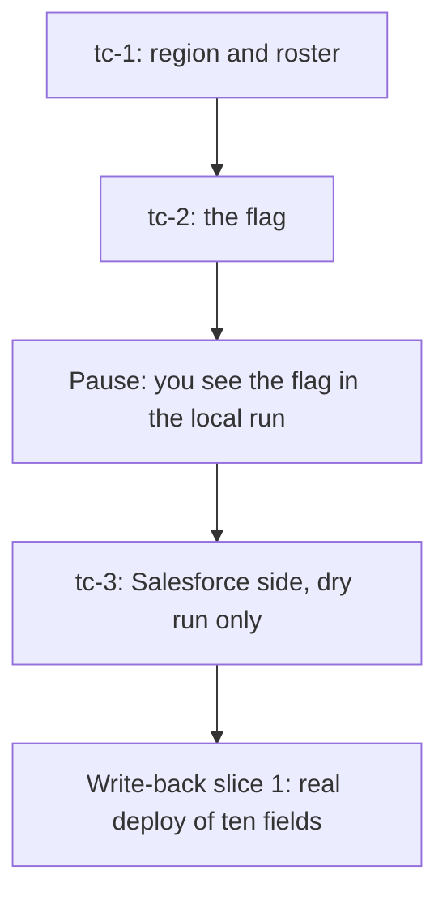

# Territory check plan

Status: proposed, awaiting approval. Source of agreement: decisions made in chat on 2026-11-14 (listed below). This plan changes [SPEC.md](../../SPEC.md) and reworks parts of [salesforce-write-back.md](salesforce-write-back.md), including one slice that is already built. Approving this plan approves those changes.

## In short

- **The flag:** every account gets a territory status: In territory, Outside territory or Not checked, with a one-line reason when it is not in territory.
- **What changes in the data:** each sample account carries a headquarters country instead of a ready-made region, and a small roster file says which territory each BDR covers.
- **What changes in Salesforce:** two new fields (Territory Status and Territory Note). Segment and Region are refreshed on every run.
- **What does not change:** the score, the tier, the BDR on the account and the Account Owner. The engine flags; it never moves an account.

Words used below: the **first load** is the first run, when the 300 accounts are created in Salesforce. **Engine fields** are the fields the engine writes on every run.

## Agreed in chat

- The engine derives the region from the company's headquarters country, the same way it derives the segment from employee count.
- An account outside its BDR's territory (segment plus region) is flagged, with a reason. Flag only. Reassignment is on the README roadmap.
- Regions live in `weights.yaml` beside segments.

## Proposed, not yet agreed (approving this plan agrees them)

Three of these are real choices, marked **Choice**. The rest follow from them.

1. **The score does not change.** Territory is a separate status beside the score. An out-of-territory account keeps its score and is ranked in the segment it truly belongs to.
2. **Choice: a country the engine does not know is reported, and the run carries on.** The account is still scored. Its territory status is "Not checked" and its note says why, for example: `Not checked: headquarters country "Iceland" is not in the country table.` The same applies when an account's BDR is not in the roster. This follows the README's rule that missing data is reported as unknown. The alternative is to stop the whole run on one unknown country, the way an employee count under 50 does today; that is simpler, but one bad row would block all 300 accounts.
3. **Choice: two Salesforce fields.** Territory Status (a picklist: In territory, Outside territory, Not checked) is for filtering and dashboards. Territory Note (text, 255 characters) holds the reason. The alternative is the note alone, where an empty note means in territory; that is one field fewer, but a dashboard cannot group on it cleanly.
4. **Choice: the headquarters country is not written to Salesforce for now.** The note already names the country when it matters. Writing it into Salesforce's standard Billing Country field risks rejection, because many orgs only accept countries from their own list, and Billing Country means the invoicing address, not the headquarters.
5. **The note carries the evidence.** Size: `Outside territory: 205 employees is Mid-Market; BDR covers SMB.` Region: `Outside territory: headquarters in Germany is EMEA; BDR covers APAC.` When both are wrong, both sentences appear.
6. **Country table.** `weights.yaml` keeps its `regions` list and gains the countries in each region. North America: United States, Canada. EMEA: United Kingdom, Germany, France, Netherlands, Israel. APAC: Australia, Singapore, Japan, India. LATAM: Brazil, Mexico, Argentina. Mexico is in LATAM by choice; a team that treats it as North America moves one line.
7. **BDR roster.** A new sample file, `data/bdrs.json`, lists each of the 60 BDRs with the segment and region they cover. A roster entry that names a segment or region missing from `weights.yaml` stops the run, because that is a mistake in the setup, not in an account.
8. **Sample data keeps every existing value.** The 300 accounts keep their names, BDRs, signals and scores. Three things are added by a plain rule:
   - Every account gets a headquarters country from its BDR's region.
   - Every 20th account (ACC-0020, ACC-0040 and so on, 15 in all) is moved outside its BDR's territory, cycling through three cases: wrong size, wrong region, both. That gives 5 of each. A wrong-size account gets an employee count from the next size band.
   - Three accounts (ACC-0050, ACC-0150, ACC-0250) get a country that is not in the table, so "Not checked" appears in the demo.
9. **Segment and Region become engine fields**, written on every run, so a company that grows shows its new segment beside its flag. When the country is unknown, Region is left alone. BDR stays first-load only and Account Owner is never touched.
10. **Rules version stays at 1.** The version tracks scoring rules, and no score changes.

## Limits to state openly (written into SPEC.md and the README)

- The flag compares against the BDR in the sample file. If someone changes the BDR in Salesforce, the engine does not see it. Reading the live owner back is part of the reassignment work on the roadmap.
- Because Segment and Region are engine fields, a manual change to them in Salesforce is overwritten on the next run. Exceptions belong to the "Overrides and history" roadmap item.
- Real territories can also use named accounts and state or postcode carve-outs. This demo uses size plus headquarters region to keep the rule readable.
- An account one employee over a band edge is flagged the same as one far over. The note shows the number so a manager can tell them apart.

## Slices

Slice names are `tc-1` to `tc-3` in the build records. Every slice ends with `python run_local.py` and `pytest` working.

| # | Slice | Files | Change | Acceptance check | Blocked by |
| --- | --- | --- | --- | --- | --- |
| tc-1 | Region and roster | `weights.yaml`, `scoring/engine.py`, `data/generate_sample.py`, `data/accounts.json`, `data/bdrs.json`, `run_local.py`, `salesforce/records.py`, `tests/`, `SPEC.md` | `weights.yaml` names the field that decides the region (`hq_country`) and lists the countries in each region. The engine returns `region` beside `segment`; an unknown or missing country gives no region and does not crash. The generator writes `hq_country` in place of `region`, writes the roster, and applies the rule in proposal 8. The local run and the Salesforce record builder read the region from the engine. Existing test accounts gain a country. | Tests, each committed and seen failing first: one country from each region lands in the right region; a country not in the table gives no region; a missing country gives no region and is listed as unknown; every region in the list has countries and no country names a region outside the list. Running the generator twice gives the same files. A separate count shows 300 accounts, 60 BDRs in the roster with 3 per territory and 5 accounts per BDR. Compared with the previous `accounts.json`, the only differences are `hq_country` replacing `region` and the employee counts of the 10 accounts moved to another size band. `python run_local.py` prints a total of 300 and the same overall tier counts as before (A 13, B 50, C 102, D 135). | nothing |
| tc-2 | The flag | `weights.yaml`, `scoring/engine.py`, `run_local.py`, `tests/`, `SPEC.md`, `README.md` | A function in the engine compares the account's territory with its BDR's and returns a status and a note. The three status names live in `weights.yaml`. The local run adds `territory_status` and `territory_note` to every score, prints the count of each status for each segment, and lists the flagged accounts with their notes, highest tier and score first. | Tests, each committed and seen failing first: same territory gives "In territory" and an empty note; wrong size, wrong region and both each give "Outside territory" and the exact note text; an unknown country and a BDR missing from the roster each give "Not checked" and the exact note; a roster entry with an unknown segment stops with an error; scoring an account gives the same score and tier whatever its BDR. `python run_local.py` shows 282 in territory, 15 outside (5 size, 5 region, 5 both) and 3 not checked. A separate count that works from the data files alone, without using the new function, gives the same three numbers. `output/scores.json` has 300 records with 11 fields each. | tc-1 |
| tc-3 | Salesforce side | `force-app/` (2 new field files, 2 field descriptions, permission set), `salesforce/records.py`, `tests/test_salesforce_records.py`, `SPEC.md`, `docs/plans/salesforce-write-back.md` | Adds the Territory Status and Territory Note fields and grants them in the permission set. Record shapes change: a new account gets Name, BDR and the engine fields; an existing account gets only the engine fields. The status and note are sent for every account on every run, and an empty note is sent as empty text so an old note is cleared. Region is left out when it is unknown. The check before writing covers the new values. This reworks write-back slice 3, which is already built and will be checked again. | A dry-run deploy reports success for all 11 components (10 fields and the permission set), and the org is confirmed unchanged afterwards. Tests, each committed and seen failing first: a new account's record holds every field; an existing account's record holds exactly the engine fields and no Name or BDR; an in-territory account's record holds the status and an empty note; an account with an unknown country has no Region in its record; a note over 255 characters or a status outside the three is reported; the Territory Status picklist holds the same three names as `weights.yaml`. | tc-2 |

The build stops after tc-2 so you can see the flag working before anything changes on the Salesforce side.

After tc-3, the write-back plan continues from its slice 1 (the real deploy, now of ten fields), then login, then write and read back.

## Amendment: tests that start green (approved by the owner on 2026-11-14)

The slice table says each listed test is "committed and seen failing first". That rule is for tests of new behaviour. A test that protects behaviour that was already correct before the slice may start green, on two conditions:

1. The build record says so.
2. A negative control is recorded: the code is broken on purpose in a scratch copy, the test is seen failing there, and the real code is left untouched.

No failure is ever faked, and correct code is never broken in the repository to produce one.

Tests this covers so far, each with its negative control:

| Test | Deliberate fault in a scratch copy | Result there |
| --- | --- | --- |
| `test_scoring_one_account_ignores_who_holds_it` (tc-2; first committed as `test_score_and_tier_do_not_depend_on_who_holds_the_account`) | Scoring takes 5 points off when the BDR is someone else | Failed: 65 is not 70 |
| `test_territory_never_changes_the_score_or_the_tier` | The full run takes 20 points off out-of-territory accounts | Failed |
| The "no region is left without countries" line in `test_every_region_has_countries_and_no_country_sits_in_two_regions` | LATAM's countries moved into EMEA | Failed |
| The territory-status case in `test_allowed_values_come_from_weights_yaml` | The allowed statuses hardcoded in the check | Failed |

## Document changes

- **SPEC.md, in tc-1:** `hq_country` replaces `region` in the input table; the Regions section says the region is derived and what happens to an unknown country; the sample-data line describes the 15 moved and 3 unknown-country accounts.
- **SPEC.md, in tc-2:** a Territory section (meaning, the three statuses, note wording, flag only, the limits above); a BDR roster input; the output gains `region`, `territory_status` and `territory_note`; the local-run acceptance line gains the three counts.
- **SPEC.md, in tc-3:** the Salesforce fields table gains the two fields and moves Segment and Region to "Engine, every run"; write-back rule 2 lists the engine fields.
- **README.md, in tc-2:** the "How it works" and "What the score means" sections describe territory; the field ownership table follows in tc-3.
- **Write-back plan, in tc-3:** slice 1 deploys ten fields; slice 3 is marked reworked by this plan; slice 4's rerun check becomes "a hand-edited BDR survives a rerun".
- **weights.yaml comment:** editing the country table does not bump the rules version, because it changes the flag and not the score.

## Dependencies

| Dependency | Needed by | Exists now? | Provider | If missing |
| --- | --- | --- | --- | --- |
| The `scoring-dev` org, for the dry run | tc-3 | yes | you | the dry run is marked unavailable and done before the real deploy |

No new library, account or credential is needed.

## Verification

| Requirement | Check | Runs now? |
| --- | --- | --- |
| Region derived from headquarters country | tc-1 tests | after tc-1 |
| Unknown country reported, never guessed, run carries on | tc-1 and tc-2 tests; the 3 "Not checked" accounts in the local run | after tc-2 |
| Out-of-territory accounts flagged with a reason | tc-2 tests on the exact note text | after tc-2 |
| The flag fires on the sample data | tc-2 local run shows 282, 15 and 3, matching a separate count | after tc-2 |
| Score unchanged by territory | tc-1 overall tier counts unchanged; tc-2 test on score and tier | after tc-2 |
| Flag only, never reassign | Reading: no code writes BDR or owner after the first load; tc-3 test that an existing account's record has no BDR | after tc-3 |
| Same data on every run | tc-1 comparison of two generator runs | after tc-1 |

## Security

None beyond the write-back plan: this adds no secret, no network call and no new outside input. The country and roster values come from files this project generates, and values that will be sent to Salesforce are still checked before anything is written.

## Risks, open decisions and fog

- Risk: the engine slices and write-back slice 3 passed an independent check or were recorded as built, and this plan changes them. One independent check at the end covers both plans.
- Risk: real country data is messy ("USA", "U.S.", "United States"). The sample uses clean names. With proposal 2, a spelling the table does not know shows up as "Not checked" instead of stopping the run. Handling variants is left for the real-signals work.
- Review: three helper reviewers challenged the first draft of this plan on 2026-11-14 (sales operations realism, consistency with the code, simplicity). Their findings are folded in. This was a helper review, not an independent check.
- Fog: real companies have a headquarters in one region and offices in others. Territory here is by headquarters only; revisit if territories need to follow subsidiaries.
- Open decision: the three choices in proposals 2, 3 and 4.

## Flow

## Approval

Approving this plan authorizes: the proposals above, with any of the three choices changed as you say; the listed document changes; writing the files in the three slices on the branch `salesforce-write-back`; regenerating the sample data; one dry-run deploy that changes nothing in the org; and committing each finished slice on the branch.

It does not authorize: the real deploy to the org (that waits for your "deploy"), committing the README roadmap edit (that waits for your say), reassigning any account, pushing, opening a pull request or merging.
